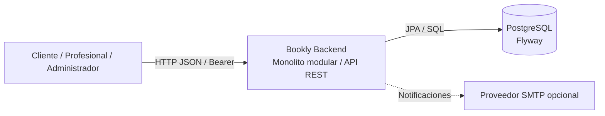
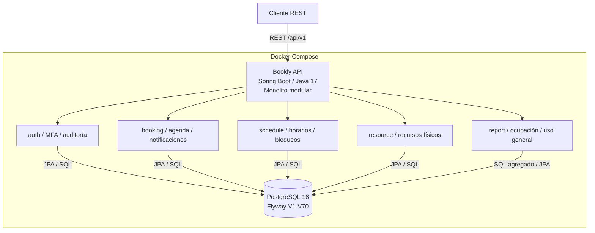
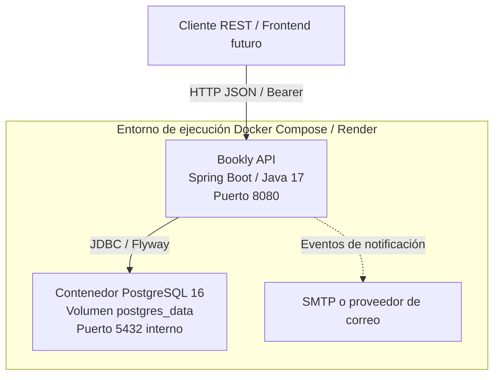
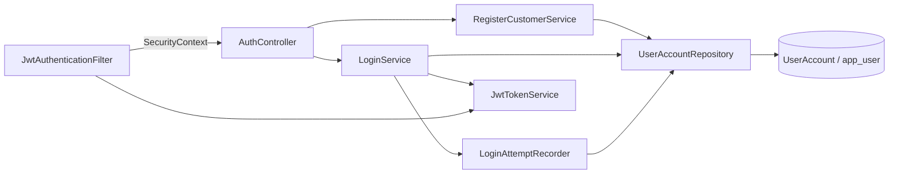
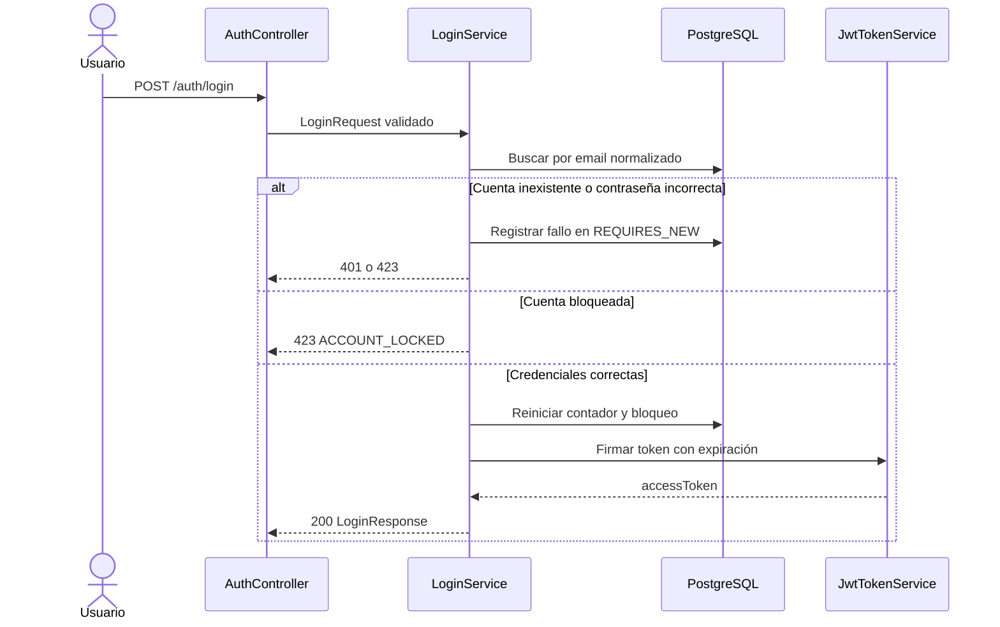
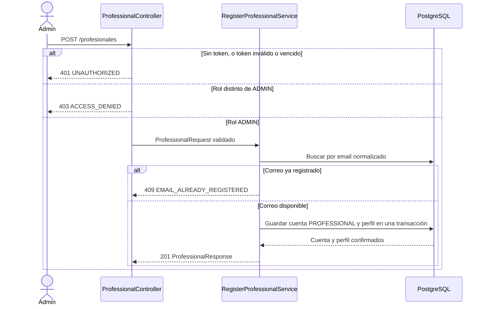
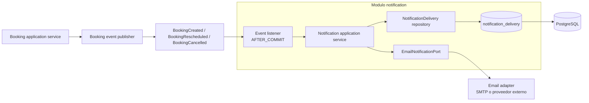
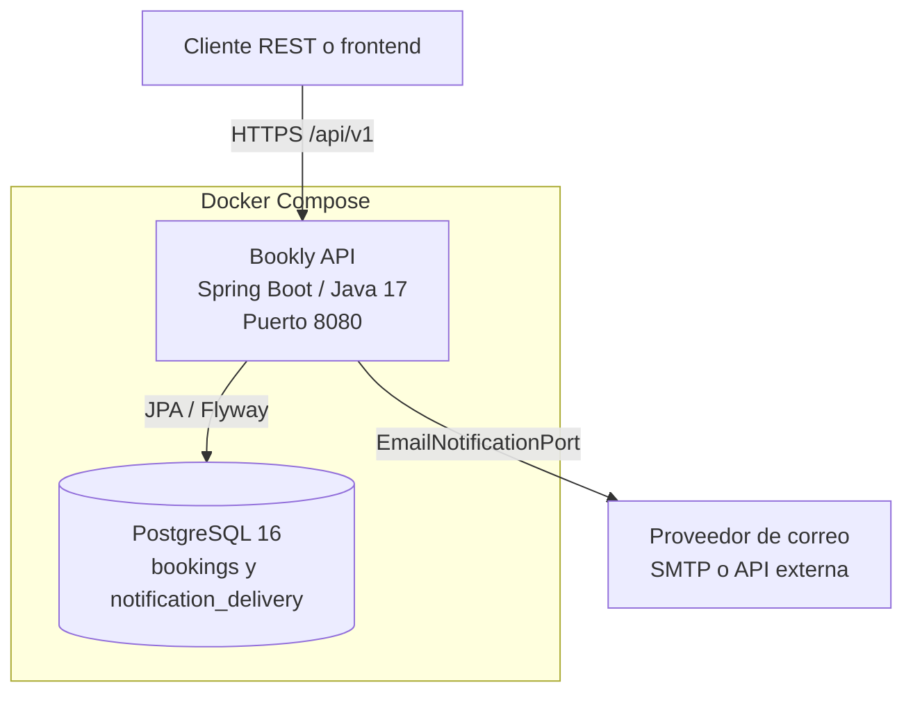

# Arquitectura de software - Entrega 3

## 1. Propósito y alcance

Este documento describe la arquitectura implementada del backend de Bookly. Sprint 1 cubrió el proyecto base Spring Boot, HU-01 (registro de cliente), HU-02 (catálogo de servicios), HU-03 (inicio de sesión seguro), HU-06 (duración estándar de servicios), HU-20 (configuración inicial), HU-21 (`OwnershipGuard`) y HU-22 (registro de profesionales). Sprint 2 agregó HU-04 (horario semanal), HU-07 (disponibilidad), HU-08 y HU-09 (reservas), HU-10 (notificaciones), HU-17 (roles), HU-18 (MFA) y HU-19 (auditoría). La Entrega 3 agrega HU-05 (bloqueos de agenda), HU-11/HU-12 (recursos físicos y capacidad), HU-13 (historial del cliente), HU-14 (agenda profesional), HU-15 (reporte de ocupación) y HU-16 (reporte general de uso). La persistencia sigue siendo PostgreSQL con migraciones Flyway; el desarrollo se ejecuta con Docker Compose y el despliegue existente utiliza Render.

La solución se mantiene como un monolito modular porque el alcance actual es pequeño, existe un único dominio principal y el equipo necesita reducir la complejidad operativa. La separación por módulos permite evolucionar a nuevos dominios sin iniciar prematuramente una arquitectura de microservicios.

## 2. Requisitos arquitectónicos

| Tipo | Requisito |
|---|---|
| Funcional | Registrar clientes e iniciar sesión con credenciales |
| Seguridad | Hash de contraseñas, validación, bloqueo temporal y autenticación Bearer |
| Integridad | Correo único, campos obligatorios y roles válidos |
| Operación | Ejecutar backend y PostgreSQL mediante Docker Compose |
| Mantenibilidad | Separar presentación, aplicación, dominio e infraestructura |
| Interoperabilidad | API REST versionada y JSON |

## 3. Vista de contexto C4



El sistema es consumido por clientes web, móviles o herramientas HTTP de prueba. El backend valida,
autentica y aplica las reglas de reservas, agendas, recursos, historiales y reportes; PostgreSQL conserva
los datos transaccionales y el proveedor SMTP recibe las notificaciones cuando está configurado.

HU-02 se implementa como un catálogo independiente de servicios. La categoría representa la
especialidad en este alcance; no se crea una entidad independiente. HU-20 concentra el nombre y la
configuración general de la plataforma. HU-06 utiliza el campo `durationMinutes` del catálogo para
validar y conservar una duración entera entre 1 y 480 minutos.

HU-22 registra a los profesionales como una cuenta con rol `PROFESSIONAL` más un perfil con su especialidad
(`profesionales`, relación 1 a 1 con `app_user`). Solo el administrador los crea. En la Entrega 3 el
profesional puede configurar su horario y bloqueos, consultar su agenda y participar en la relación
`profesional_servicio`; `OwnershipGuard` limita el acceso a su propia información.

## 4. Vista de contenedores C4



## 5. Vista de despliegue



El backend es stateless y la base conserva el estado transaccional. El volumen de PostgreSQL debe
respaldarse y no debe compartirse entre entornos. `JWT_SECRET` se inyecta como secreto de configuración
y no se almacena en la imagen.

El contenedor backend es stateless: no mantiene sesión HTTP. El estado de cuenta, intentos fallidos y bloqueo se almacenan en PostgreSQL. El token firmado permite autenticar solicitudes posteriores.

## 6. Vista de componentes del módulo de autenticación



### Interfaces principales

| Componente | Interfaz o responsabilidad |
|---|---|
| `AuthController` | `POST /api/v1/auth/register` y `POST /api/v1/auth/login` |
| `RegisterCustomerService` | Normalizar email/nombre, validar duplicados y guardar BCrypt como `CUSTOMER` |
| `LoginService` | Validar cuenta, contraseña, estado de bloqueo y emitir respuesta |
| `LoginAttemptRecorder` | Persistir fallos en una transacción independiente para evitar rollback del contador |
| `JwtTokenService` | Firmar y validar token HMAC-SHA256 con `sub`, `email`, `role` y `exp` |
| `JwtAuthenticationFilter` | Leer `Authorization: Bearer`, validar token y poblar `SecurityContext` |
| `UserAccountRepository` | Acceso JPA a `app_user` por UUID y email |
| `GlobalExceptionHandler` | Contrato uniforme para errores de validación, registro y autenticación |

### Componentes de HU-02, HU-06, HU-20 y HU-22

| Módulo | Responsabilidad |
|---|---|
| `ServiceOfferingController` | CRUD de `/api/v1/servicios` y filtro público por `categoria` |
| `ServiceOfferingService` | Normalización, validación funcional y estado inicial `ACTIVO` |
| `ServiceOfferingRepository` | Persistencia y unicidad lógica del nombre del servicio |
| `PlatformSetupController` | Aprovisionamiento único mediante `POST /api/v1/platform/setup` |
| `PlatformSetupService` | Validación de la configuración y traducción de concurrencia a `409` |
| `ProfessionalController` | Alta de profesionales mediante `POST /api/v1/profesionales`, exclusiva de `ADMIN` |
| `RegisterProfessionalService` | Normalización, creación de la cuenta `PROFESSIONAL` y su perfil en una transacción, y traducción del correo duplicado a `409` |
| `ProfessionalRepository` | Persistencia del perfil en `profesionales`, con el mismo `id` que la cuenta |

### Componentes de HU-07 (consulta de disponibilidad de agenda)

El módulo `availability` no tiene tablas propias: calcula los bloques libres a partir de los datos de
`schedule`, `catalog`, `professional` y `booking`, que consulta a través del puerto `AvailabilityQuery`.

| Componente | Responsabilidad |
|---|---|
| `AvailabilityController` | `GET /api/v1/disponibilidad` con `profesionalId`, `servicioId`, `desde` y `hasta`; solo rol CUSTOMER |
| `AvailabilityService` | Valida el rango (máximo 31 días, no pasado), verifica profesional y servicio activo y arma la respuesta; informa cuando no hay cupos |
| `AvailabilityQuery` | Puerto que declara los datos necesarios: existencia del profesional, duración del servicio, franjas semanales y reservas ocupadas |
| `AvailabilityQueryAdapter` | Implementa el puerto con `ProfessionalRepository`, `ServiceOfferingRepository`, `WeeklySlotRepository` y `BookingRepository` |
| `AvailabilityCalculator` | Regla de dominio: genera bloques consecutivos con la duración del servicio y descarta los pasados y los solapados con reservas `CONFIRMADA`, `RESCHEDULED` o `COMPLETED` |
| `InvalidAvailabilityQueryException` | Parámetros faltantes o inválidos; `GlobalExceptionHandler` la traduce a `400 VALIDATION_ERROR` |

La consulta es informativa: no bloquea bloques. La integridad ante reservas simultáneas sigue
garantizada por `POST /api/v1/reservas` (ver ADR-006).

### Componentes de HU-05, HU-11 y HU-12 (agenda y recursos)

Los módulos `schedule` y `resource` mantienen sus propias reglas y exponen puertos para que `booking` y
`report` consulten la información necesaria sin acoplarse a entidades JPA de otros módulos.

| Módulo | Componente | Responsabilidad |
|---|---|---|
| `schedule` | `AgendaBlockController` / `AgendaBlockService` | Crear, listar y eliminar bloqueos de agenda para `PROFESSIONAL` o `ADMIN`, respetando `OwnershipGuard`. |
| `schedule` | `AgendaBlockRepository` | Persistir rangos de bloqueo y serializar operaciones concurrentes sobre el profesional. |
| `resource` | `PhysicalResourceController` / `PhysicalResourceService` | CRUD de recursos físicos, exclusivo de `ADMIN`. |
| `resource` | `ServiceResourceAssignmentController` / `ServiceResourceAssignmentService` | Asignar y retirar recursos de los servicios, exclusivo de `ADMIN`. |
| `resource` | `ResourceCapacityValidator` | Verificar, dentro de la transacción de reserva, que el uso de recursos no supere `cantidad_total`. |
| `booking` | `BookingRepository` | Considerar `CONFIRMADA`, `RESCHEDULED` y `COMPLETED` como estados que ocupan agenda; `CANCELADA` libera la franja. |

Los bloqueos descuentan capacidad en el reporte de ocupación y participan en la validación de disponibilidad
y creación de reservas. La integridad de rangos y solapamientos se refuerza en PostgreSQL mediante `V50`.

### Componentes de HU-13 y HU-14 (historiales y agenda)

| Componente | Responsabilidad |
|---|---|
| `CustomerBookingHistoryService` | Consultar el historial propio del cliente con filtros, orden y paginación. |
| `BookingController` | Exponer `/reservas/cliente/historial` y conservar la ruta antigua por compatibilidad; las lecturas administrativas de otro cliente se auditan. |
| `ProfessionalAgendaService` | Consultar la agenda del profesional para hoy o un rango inclusivo de máximo 31 días. |
| `ProfessionalAgendaController` | Aplicar el rol y la propiedad del profesional: `PROFESSIONAL` solo consulta su agenda y `ADMIN` debe indicar `professionalId`. |
| `BookingRepository.findAgenda` | Devolver reservas no canceladas ordenadas por fecha, usando el índice de profesional y fecha. |

La ruta anterior `/reservas/profesional/{professionalId}` permanece obsoleta pero disponible hasta que el
frontend migre a `/reservas/profesional/agenda`. Los contratos completos y la guía de migración están en
[`docs/HU-13-historial-reservas-cliente.md`](docs/HU-13-historial-reservas-cliente.md),
[`docs/HU-14-agenda-profesional.md`](docs/HU-14-agenda-profesional.md) y [`docs/openapi.yaml`](docs/openapi.yaml).

### Componentes de HU-15 (reporte de ocupación)

El módulo `report` no tiene tablas propias: calcula la ocupación a partir de los datos de `booking`,
`schedule`, `professional` y `auth`, que consulta a través del puerto `OccupancyQuery`.

| Componente | Responsabilidad |
|---|---|
| `ReportController` | `GET /api/v1/reportes/ocupacion` con `periodo` o con el rango `desde`/`hasta`; solo rol `ADMIN` |
| `ReportPeriodConverter` | Convierte `periodo` sin distinguir mayúsculas; un valor desconocido termina en `400 VALIDATION_ERROR` por el `GlobalExceptionHandler` |
| `OccupancyReportService` | Calcula la ventana de 7/30 días o el rango propio de máximo 366 días y arma la respuesta por día y profesional |
| `OccupancyQuery` | Puerto que declara los datos necesarios: profesionales, franjas semanales, reservas que ocupan agenda y nombres |
| `OccupancyQueryAdapter` | Implementa el puerto con `ProfessionalRepository`, `WeeklySlotRepository`, `BookingRepository` y `UserAccountRepository` |
| `OccupancyCalculator` | Une franjas solapadas, descuenta bloqueos, calcula el porcentaje sin tope y devuelve `null` cuando hay reservas y capacidad cero |

El reporte es de solo lectura (`@Transactional(readOnly = true)`) y usa `idx_bookings_start_time`. Las reservas
que ocupan agenda son `CONFIRMADA`, `RESCHEDULED` y `COMPLETED`; si no hay reservas responde ceros. Los
bloqueos de agenda se consultan mediante `OccupancyQuery.findAgendaBlocks` y se restan de la capacidad.

### Componentes de HU-16 (reporte general de uso)

| Componente | Responsabilidad |
|---|---|
| `GeneralReportController` | Exponer el reporte general solo a `ADMIN` con MFA verificada. |
| `GeneralReportService` | Coordinar reservas totales, cancelaciones, ingresos y uso de recursos por periodo. |
| `GeneralReportQueryAdapter` | Ejecutar agregaciones SQL sobre reservas, servicios, recursos y el precio histórico. |
| `ReportSessionActivity` | Expirar la sesión del reporte después de 15 minutos sin actividad. |
| `AuditRecorder` | Registrar cada consulta como `REPORT_VIEWED` con actor, IP, periodo y rango. |

HU-16 utiliza los módulos `resource` y `booking` mediante consultas de lectura. El precio se toma de
`bookings.price_at_booking` para que los ingresos históricos no cambien cuando se modifique el catálogo.

## 7. Flujo de login



### Flujo de registro de profesionales



## 8. Seguridad implementada y pendientes

Implementado: BCrypt, política de contraseña, normalización de email, respuestas genéricas ante credenciales inválidas, bloqueo temporal, token firmado y expiración, API stateless, validación de payloads y secretos configurables por ambiente. `JWT_SECRET` es obligatorio, persistente y no se genera automáticamente al iniciar. Las solicitudes sin autenticación responden `401 UNAUTHORIZED` y los usuarios autenticados sin permisos responden `403 ACCESS_DENIED`, ambos con el contrato de error uniforme. El alta de profesionales (`/api/v1/profesionales`) y la gestión de recursos solo las puede ejecutar `ADMIN`. HU-16 requiere `ADMIN` con MFA verificada; HU-15 requiere `ADMIN`. Las lecturas críticas de reportes e historiales se registran en `audit_log`.

Pendiente para completar los lineamientos avanzados: MFA para administración, revocación y rotación de tokens, cookies `HttpOnly`/`Secure` si el cliente las requiere, CORS restringido, rate limiting por IP/cuenta, logs estructurados de eventos de seguridad, invitación por correo o cambio de la contraseña inicial de los profesionales y SCA/SAST/DAST.

## 9. Decisiones arquitectónicas (ADR)

### ADR-001: Monolito modular

- **Estado:** Aceptada.
- **Contexto:** El Sprint 1 contiene autenticación y persistencia inicial.
- **Decisión:** Usar un backend Spring Boot organizado por módulos (`auth`, `shared`) y capas explícitas.
- **Alternativas:** Microservicios desde el inicio; arquitectura CRUD sin separación.
- **Consecuencias:** Menor costo de despliegue y depuración; se requiere disciplina para evitar acoplamiento entre dominios.

### ADR-002: PostgreSQL como persistencia transaccional

- **Estado:** Aceptada.
- **Contexto:** Usuarios, roles, restricciones y estado de bloqueo requieren consistencia.
- **Decisión:** PostgreSQL 16 como fuente de verdad, accedido mediante Spring Data JPA.
- **Alternativas:** Base documental; servicio administrado sin control local.
- **Consecuencias:** Integridad mediante constraints y facilidad de ejecución local; las migraciones deben versionarse y aplicarse correctamente.

### ADR-003: BCrypt y token Bearer HMAC-SHA256

- **Estado:** Aceptada para Sprint 1.
- **Contexto:** Se necesita autenticación stateless sin almacenar contraseñas en claro.
- **Decisión:** Guardar solo BCrypt y emitir tokens firmados con expiración configurable.
- **Alternativas:** Sesiones HTTP; OAuth/OIDC externo; almacenar contraseñas cifradas reversiblemente.
- **Consecuencias:** Escalamiento sencillo y menor estado en el backend; se deben agregar rotación, revocación y MFA para producción avanzada.

### ADR-004: Persistir el fallo fuera de la transacción de respuesta

- **Estado:** Aceptada.
- **Contexto:** Devolver una excepción después de incrementar el contador provocaba rollback.
- **Decisión:** `LoginAttemptRecorder` usa `REQUIRES_NEW` para confirmar el contador antes de responder `401` o `423`.
- **Consecuencias:** El bloqueo es durable; requiere revisar concurrencia y control de intentos distribuidos en una futura evolución.

### ADR-005: Alcance reducido de HU-02

- **Estado:** Aceptada.
- **Decisión:** HU-02 se limita al catálogo de servicios; la especialidad se representa mediante la
  categoría del servicio. La configuración general y los datos de contacto pertenecen a HU-20.
- **Consecuencia:** No se crean tablas ni endpoints independientes de organización o especialidades
  en este sprint.
- **Detalle:** [ADR-005 - Alcance HU-02](docs/ADR-005-alcance-HU-02.md).

### ADR-006: Concurrencia e integridad en operaciones únicas

- **Estado:** Aceptada.
- **Decisión:** PostgreSQL garantiza la unicidad del correo y de la plataforma; los casos de uso
  ejecutan `saveAndFlush()` y traducen las violaciones a respuestas `409` funcionales.
- **Detalle:** [ADR-006 - Concurrencia e integridad](docs/ADR-006-concurrencia-integridad.md).

## 10. Contrato de API

El contrato REST versionado se encuentra en [docs/openapi.yaml](docs/openapi.yaml). Toda modificación
de rutas, payloads, códigos HTTP o esquemas debe actualizar este archivo en el mismo cambio.

## 11. Estructura del código

```text
src/main/java/com/bookly/backendcf/
├── auth/
│   ├── application/       # casos de uso y reglas de autenticación
│   ├── configuration/      # BCrypt y Spring Security
│   ├── domain/model/       # UserAccount y UserRole
│   ├── infrastructure/    # repositorios JPA
│   ├── presentation/      # controlador y DTOs REST
│   └── security/           # emisión y filtro JWT
├── availability/
│   ├── application/       # caso de uso y puerto de consulta
│   ├── domain/model/      # reglas de cálculo de bloques libres
│   ├── infrastructure/    # adaptador sobre los repositorios de otros módulos
│   └── presentation/      # controlador y DTO REST
├── booking/                # reservas, historial de cliente y agenda profesional
├── schedule/               # horarios semanales y bloqueos de agenda
├── resource/               # recursos físicos y asignación a servicios
├── report/                 # reportes de ocupación y uso general
├── professional/           # perfiles y consultas de profesionales
├── catalog/                # catálogo de servicios
├── notification/           # eventos y entregas de correo
└── shared/error/          # errores HTTP uniformes
```

## 12. Evidencia y próximos pasos

La aplicación compila y cuenta con despliegue definido mediante Docker Compose. El esquema se versiona
con Flyway y las migraciones de esta entrega llegan hasta `V70`, incluyendo bloqueos de agenda, recursos,
precio histórico e índices y eventos de auditoría de reportes e historiales. Se validaron localmente la
compilación y las pruebas dirigidas de los módulos de reportes, recursos y agenda; la suite y el Quality
Gate completos se evidencian en el pipeline y en el PR de integración de Calidad.

## 13. Componentes de HU-10: notificaciones de reserva

El siguiente diagrama documenta la integración propuesta entre `booking` y `notification` dentro del
monolito modular. `notification` depende de contratos de eventos y no de las entidades JPA internas
de `booking`, `auth`, `catalog` o `professional`.



### Responsabilidades

| Componente | Responsabilidad |
|---|---|
| `BookingEventPublisher` | Publicar el contrato de eventos de reserva |
| `NotificationEventListener` | Recibir eventos después del commit |
| `NotificationService` | Seleccionar plantilla, registrar el intento y coordinar el envío |
| `EmailNotificationPort` | Contrato de aplicación para enviar correos |
| `EmailNotificationAdapter` | Integrar SMTP o el proveedor configurado |
| `NotificationDeliveryRepository` | Consultar y persistir estados de entrega |
| `notification_delivery` | Fuente de verdad del estado técnico del envío |

Este diseño se encuentra en estado propuesto hasta que Miguel confirme la estructura final de los
eventos de HU-08/HU-09. La decisión completa está documentada en
[ADR-011](docs/ADR-011-notificaciones-por-eventos.md).

## 14. Vista de despliegue de HU-10



La API y PostgreSQL se despliegan en el entorno contenerizado existente. El proveedor de correo no
forma parte de la imagen del backend: sus credenciales se inyectan mediante variables de entorno o
secretos del entorno. En pruebas se utilizará un adaptador controlado que no dependa de un proveedor
externo.

El módulo mantiene el backend stateless; el estado transaccional de la reserva y el estado técnico
de la entrega permanecen en PostgreSQL. El envío es eventual y no debe revertir una reserva que ya
fue confirmada.
