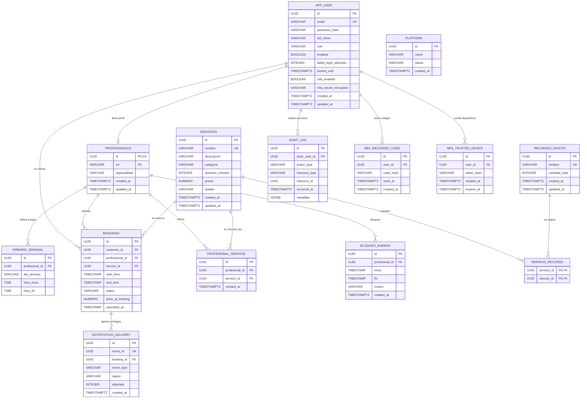
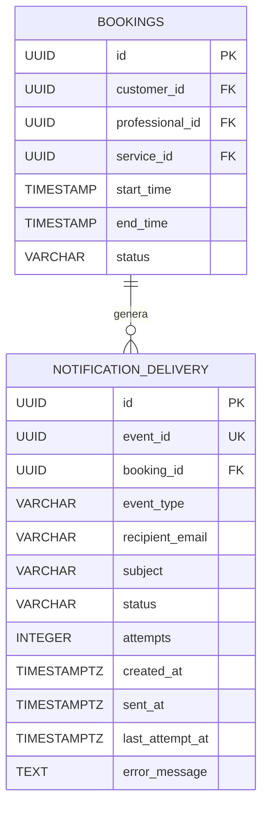
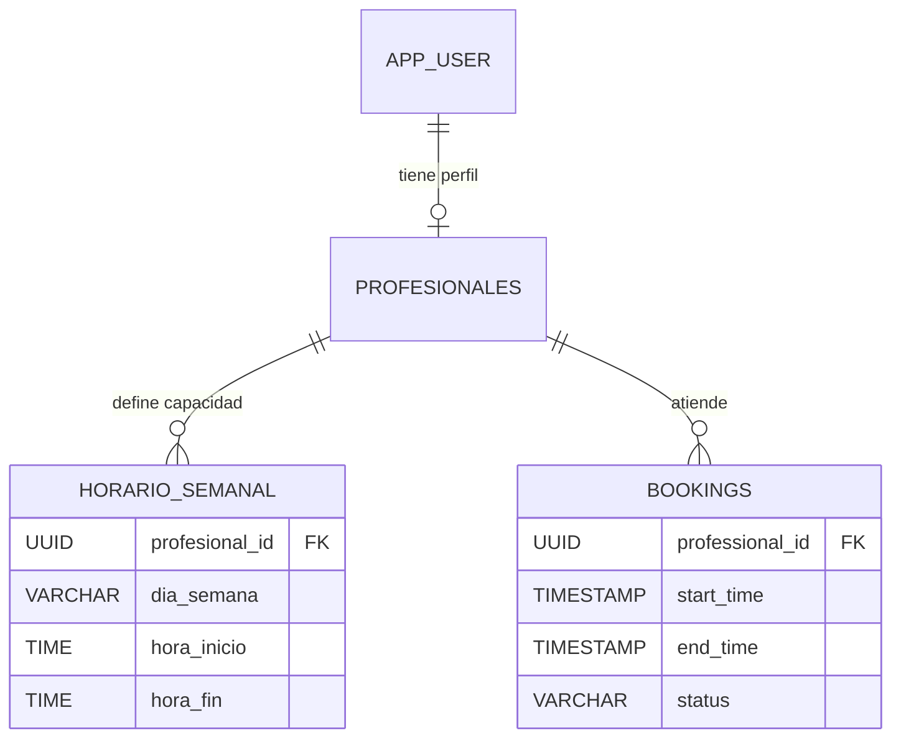

# Base de datos - Entrega 3

## 1. Propósito y alcance

Este documento presenta el diseño lógico y físico implementado de Bookly para HU-01 (registro de cliente), HU-02 (catálogo de servicios), HU-03 (inicio de sesión seguro), HU-06 (duración estándar de servicios), HU-20 (configuración inicial de la plataforma) y HU-22 (registro de profesionales). También documenta la evolución de Sprint 2 y la Entrega 3: reservas, notificaciones, bloqueos de agenda (HU-05), recursos físicos y capacidad (HU-11/HU-12), historial del cliente (HU-13), agenda profesional (HU-14), reporte de ocupación (HU-15) y reporte general de uso (HU-16). PostgreSQL es la fuente de verdad y Flyway administra las migraciones.

Las especialidades de HU-02 se representan mediante `servicios.categoria`, de acuerdo con el [ADR-005](docs/ADR-005-alcance-HU-02.md); no existe una entidad independiente porque no hay reglas que la justifiquen. La especialidad de un profesional (HU-22) sigue el mismo criterio: es un atributo de `profesionales.especialidad`. Las entidades de agenda, reservas, recursos y auditoría se relacionan mediante UUID y mantienen las reglas de negocio críticas en constraints, índices y migraciones versionadas.

## 2. Entidades y relaciones

### Diagrama ER



El diagrama representa el esquema completo de la entrega final. `APP_USER` se relaciona con profesionales,
clientes, auditoría y MFA; `PROFESIONALES` se relaciona con horarios, reservas, bloqueos y servicios ofrecidos;
`SERVICIOS` se relaciona con reservas, profesionales y recursos físicos. `PLATFORM` es una tabla singleton y
no tiene FK hacia otra entidad.

`AUDIT_LOG.resource_id` es intencionalmente un identificador polimórfico y no una FK: puede referirse a un
`BOOKING`, `USER` o `REPORT` según `resource_type`. La FK de trazabilidad es `actor_user_id → app_user.id`.
Las relaciones N:M se implementan mediante `PROFESIONAL_SERVICIO` y `SERVICIO_RECURSO`.

## 3. Reglas de negocio persistidas

| Regla | Implementación |
|---|---|
| Cada cuenta tiene un identificador | `id UUID PRIMARY KEY` |
| El correo identifica una cuenta | `email NOT NULL UNIQUE`, longitud máxima 320 |
| No se almacenan contraseñas en claro | `password_hash` recibe BCrypt desde la aplicación |
| Toda cuenta tiene rol | `role NOT NULL` y `CHECK` para `CUSTOMER`, `PROFESSIONAL`, `ADMIN` |
| Una cuenta nueva está habilitada | `enabled NOT NULL`, valor inicial `TRUE` |
| Los fallos son contables | `failed_login_attempts NOT NULL DEFAULT 0` |
| El bloqueo puede estar ausente | `locked_until` permite `NULL` cuando no hay bloqueo |
| Las fechas son trazables | `created_at` y `updated_at` son obligatorias |
| Solo una cuenta `PROFESSIONAL` puede tener perfil de profesional | `profesionales.rol` vale siempre `PROFESSIONAL` (`DEFAULT` y `CHECK`) y la FK compuesta `(id, rol)` apunta a `app_user (id, role)`: la base rechaza el perfil de una cuenta con otro rol |
| Cada cuenta tiene como máximo un perfil | `profesionales.id` es la clave primaria y a la vez la FK hacia la cuenta |
| La especialidad es obligatoria | `especialidad NOT NULL`, máximo 100 y `CHECK` que impide cadenas vacías o de solo espacios |
| Una cuenta con perfil no se elimina ni cambia de rol | La FK no tiene `ON DELETE CASCADE` ni `ON UPDATE CASCADE`: la cuenta se deshabilita con `enabled = FALSE` |

## 4. Modelo lógico

### APP_USER

| Atributo | Tipo lógico | Nulabilidad | Clave / dominio | Descripción |
|---|---|---:|---|---|
| `id` | Identificador UUID | No | PK | Identificador interno |
| `email` | Cadena de correo | No | UK, máximo 320 | Credencial funcional normalizada a minúsculas |
| `password_hash` | Cadena hash | No | — | Resultado de BCrypt |
| `full_name` | Cadena | No | Máximo 150 | Nombre mostrado |
| `role` | Enumeración | No | CUSTOMER, PROFESSIONAL, ADMIN | Rol de autorización futuro |
| `enabled` | Booleano | No | — | Permite deshabilitar la cuenta |
| `failed_login_attempts` | Entero | No | >= 0 por regla de aplicación | Intentos fallidos acumulados |
| `locked_until` | Fecha-hora con zona | Sí | — | Fin del bloqueo temporal |
| `created_at` | Fecha-hora con zona | No | — | Fecha de creación |
| `updated_at` | Fecha-hora con zona | No | — | Última actualización |

El modelo se encuentra normalizado para este alcance: cada atributo es atómico, no existen grupos repetidos ni dependencias parciales, y los atributos describen únicamente a la cuenta. El diseño cumple el objetivo de 3FN para la entidad actual.

### PLATFORM

| Atributo | Tipo lógico | Nulabilidad | Clave / dominio | Descripción |
|---|---|---:|---|---|
| `id` | Identificador UUID | No | PK, una sola fila | Identificador de la plataforma |
| `name` | Cadena | No | Máximo 200 | Nombre de la plataforma |
| `status` | Enumeración | No | ACTIVE, SUSPENDED | Estado operativo |
| `created_at` | Fecha-hora con zona | No | — | Fecha de aprovisionamiento |

La unicidad de `platform` se garantiza mediante el índice único sobre la expresión constante `true`.

### SERVICIOS

| Atributo | Tipo lógico | Nulabilidad | Clave / dominio | Descripción |
|---|---|---:|---|---|
| `id` | Identificador UUID | No | PK | Identificador interno |
| `nombre` | Cadena | No | Único sin distinguir mayúsculas, máximo 150 | Nombre comercial del servicio |
| `descripcion` | Cadena | Sí | Máximo 500 | Descripción opcional |
| `categoria` | Cadena | No | Máximo 100 | Especialidad funcional del servicio |
| `duracion_minutos` | Entero | No | 1 a 480 | Duración usada por futuras agendas |
| `precio` | Decimal | No | Mayor que 0, máximo 2 decimales | Precio del servicio |
| `estado` | Enumeración | No | ACTIVO, INACTIVO | Disponibilidad del servicio |
| `created_at` | Fecha-hora con zona | No | — | Fecha de creación |
| `updated_at` | Fecha-hora con zona | No | — | Última actualización |

`servicios` se mantiene independiente en este sprint. La asignación de profesionales a servicios y la
relación con reservas se agregarán cuando las HUs correspondientes definan sus claves foráneas y reglas
de negocio.

### PROFESIONALES

| Atributo | Tipo lógico | Nulabilidad | Clave / dominio | Descripción |
|---|---|---:|---|---|
| `id` | Identificador UUID | No | PK; FK compuesta con `rol` hacia `app_user` | Mismo identificador de la cuenta del profesional |
| `rol` | Cadena | No | Siempre `PROFESSIONAL` | Rol que debe tener la cuenta; sostiene la FK compuesta |
| `especialidad` | Cadena | No | Máximo 100, no vacía | Especialidad funcional del profesional |
| `created_at` | Fecha-hora con zona | No | — | Fecha de creación del perfil |
| `updated_at` | Fecha-hora con zona | No | — | Última actualización |

El nombre, el correo y la contraseña del profesional viven en `app_user`; `profesionales` solo guarda lo
que describe al perfil, por lo que no hay datos duplicados. La columna `rol` es la única redundancia y es
deliberada: existe para que la FK compuesta `(id, rol)` haga que la base, y no solo la aplicación, garantice
que únicamente una cuenta `PROFESSIONAL` puede tener perfil. Como vale siempre `PROFESSIONAL` por defecto,
la aplicación no la mapea ni la envía.

Compartir la clave primaria hace que el identificador del profesional sea el mismo UUID que el token JWT
lleva en `sub`, que es el valor que `OwnershipGuard` compara al proteger recursos propios como la agenda.

Consecuencia: mientras una cuenta tenga perfil de profesional no se puede cambiar su rol. Cuando exista el
flujo de cambio de roles (HU-17), quitar a alguien de `PROFESSIONAL` exigirá eliminar antes su perfil.

## 5. Preguntas de negocio y consultas clave

Las siguientes preguntas cubren filtros, agregaciones y consultas de estado. Las consultas son ejemplos para PostgreSQL y deben ejecutarse sobre el esquema creado por Flyway.

### 1. ¿Existe una cuenta con un correo determinado?

```sql
SELECT id, email, enabled
FROM app_user
WHERE email = LOWER('juan@example.com');
```

### 2. ¿Cuántas cuentas existen por rol?

```sql
SELECT role, COUNT(*) AS total
FROM app_user
GROUP BY role
ORDER BY role;
```

### 3. ¿Qué cuentas están bloqueadas actualmente?

```sql
SELECT email, failed_login_attempts, locked_until
FROM app_user
WHERE locked_until IS NOT NULL
  AND locked_until > CURRENT_TIMESTAMP
ORDER BY locked_until;
```

### 4. ¿Qué cuentas acumulan más intentos fallidos?

```sql
SELECT email, failed_login_attempts, locked_until
FROM app_user
WHERE failed_login_attempts > 0
ORDER BY failed_login_attempts DESC, email;
```

### 5. ¿Cuántas cuentas se registraron por día?

```sql
SELECT created_at::date AS registration_date, COUNT(*) AS total
FROM app_user
GROUP BY created_at::date
ORDER BY registration_date DESC;
```

### 6. ¿Qué porcentaje de cuentas está habilitado?

```sql
SELECT ROUND(100.0 * COUNT(*) FILTER (WHERE enabled) / NULLIF(COUNT(*), 0), 2)
       AS enabled_percentage
FROM app_user;
```

### 7. ¿Qué servicios activos existen por categoría?

```sql
SELECT categoria, COUNT(*) AS total_servicios
FROM servicios
WHERE estado = 'ACTIVO'
GROUP BY categoria
ORDER BY categoria;
```

### 8. ¿Qué servicios requieren más tiempo de atención?

```sql
SELECT nombre, categoria, duracion_minutos, precio
FROM servicios
WHERE estado = 'ACTIVO'
ORDER BY duracion_minutos DESC, nombre;
```
### 9. ¿Cuántos profesionales hay por especialidad?

```sql
SELECT especialidad, COUNT(*) AS total_profesionales
FROM profesionales
GROUP BY especialidad
ORDER BY total_profesionales DESC, especialidad;
```

### 10. ¿Qué profesionales están habilitados y con qué especialidad?

```sql
SELECT u.id, u.full_name, u.email, p.especialidad
FROM profesionales p
JOIN app_user u ON u.id = p.id
WHERE u.enabled
ORDER BY p.especialidad, u.full_name;
```

### 11. ¿Qué especialidades no tienen ningún servicio activo en el catálogo?

```sql
SELECT DISTINCT p.especialidad
FROM profesionales p
WHERE NOT EXISTS (
    SELECT 1
    FROM servicios s
    WHERE s.estado = 'ACTIVO'
      AND lower(s.categoria) = lower(p.especialidad)
)
ORDER BY p.especialidad;
```

### 12. Consistencia: ¿hay cuentas `PROFESSIONAL` sin perfil?

Con datos consistentes debe devolver 0 filas. La base impide el caso contrario (un perfil sobre una cuenta
que no es `PROFESSIONAL`), pero no que una cuenta con ese rol exista sin perfil.

```sql
SELECT u.id, u.email
FROM app_user u
LEFT JOIN profesionales p ON p.id = u.id
WHERE u.role = 'PROFESSIONAL'
  AND p.id IS NULL;
```
## 6. Modelo físico PostgreSQL

El modelo físico lo aplica **Flyway** al arrancar, desde `src/main/resources/db/migration`:

- `V1__baseline_app_user.sql`: creación inicial de `app_user`.
- `V2__add_login_security.sql`: columnas de bloqueo de cuenta y CHECK de roles (antes `002-add-login-security.sql`).
- `V3__create_platform.sql`: tabla `platform`, limitada a una sola fila.
- `V4__rename_patient_role_to_customer.sql`: migra el rol histórico `PATIENT` a `CUSTOMER` y actualiza la restricción.
- `V5__create_service_catalog.sql`: tabla `servicios` y sus restricciones de catálogo.
- `V6__create_professionals.sql`: tabla `profesionales` (perfil 1 a 1 de `app_user` con la especialidad) y la restricción que solo admite cuentas con rol `PROFESSIONAL`.
- `V10__create_weekly_schedule.sql`: franjas del horario semanal de cada profesional.
- `V30__create_bookings.sql` y `V31__allow_rebooking_cancelled_slots.sql`: reservas, estados e índices de consulta.
- `V40__create_audit_log.sql`, `V41__mfa_totp.sql` y `V42__mfa_trusted_devices.sql`: auditoría append-only y soporte de MFA.
- `V43__create_notification_delivery.sql`, `V44__cascade_notification_delivery_booking.sql` y `V45__create_professional_service.sql`: notificaciones y relación profesional-servicio.
- `V46__prevent_overlapping_confirmed_bookings.sql`, `V47__occupying_statuses_block_overlaps.sql` y `V50__create_agenda_blocks.sql`: integridad de solapamientos y bloqueos de agenda.
- `V55__create_physical_resources.sql` y `V56__create_service_resource.sql`: recursos físicos, cantidades y asignación a servicios.
- `V65__add_booking_price_snapshot.sql`: precio histórico de la reserva para ingresos estables.
- `V66__create_general_report_indexes.sql`: índices para agregaciones de reportes.
- `V67__allow_report_audit_events.sql` y `V70__allow_customer_history_audit.sql`: tipos de auditoría de reportes e historial.

La unicidad de `app_user.email` y la existencia de una sola fila en `platform` se resuelven en
PostgreSQL mediante restricciones/índices únicos. La aplicación traduce sus violaciones a errores
funcionales `409`, según [ADR-006](docs/ADR-006-concurrencia-integridad.md).

DDL equivalente para una base nueva:

```sql
CREATE TABLE IF NOT EXISTS app_user (
    id UUID NOT NULL,
    email VARCHAR(320) NOT NULL,
    password_hash VARCHAR(255) NOT NULL,
    full_name VARCHAR(150) NOT NULL,
    role VARCHAR(30) NOT NULL,
    enabled BOOLEAN NOT NULL,
    failed_login_attempts INTEGER NOT NULL DEFAULT 0,
    locked_until TIMESTAMPTZ,
    created_at TIMESTAMPTZ NOT NULL,
    updated_at TIMESTAMPTZ NOT NULL,
    CONSTRAINT pk_app_user PRIMARY KEY (id),
    CONSTRAINT uk_app_user_email UNIQUE (email),
    CONSTRAINT ck_app_user_role
        CHECK (role IN ('CUSTOMER', 'PROFESSIONAL', 'ADMIN'))
);
```

Las tablas `platform`, `servicios` y `profesionales` se crean mediante `V3__create_platform.sql`,
`V5__create_service_catalog.sql` y `V6__create_professionals.sql`, respectivamente. No deben copiarse
manualmente en producción: Flyway administra el orden y el historial de aplicación.

DDL de `profesionales` (HU-22), tal como lo aplica `V6__create_professionals.sql`:

```sql
ALTER TABLE app_user
    ADD CONSTRAINT uk_app_user_id_role UNIQUE (id, role);

CREATE TABLE profesionales (
    id UUID NOT NULL,
    rol VARCHAR(30) NOT NULL DEFAULT 'PROFESSIONAL',
    especialidad VARCHAR(100) NOT NULL,
    created_at TIMESTAMPTZ NOT NULL,
    updated_at TIMESTAMPTZ NOT NULL,
    CONSTRAINT pk_profesionales PRIMARY KEY (id),
    CONSTRAINT ck_profesionales_rol CHECK (rol = 'PROFESSIONAL'),
    CONSTRAINT ck_profesionales_especialidad CHECK (length(btrim(especialidad)) > 0),
    CONSTRAINT fk_profesionales_app_user_rol FOREIGN KEY (id, rol) REFERENCES app_user (id, role)
);
```

`uk_app_user_id_role` no agrega una regla nueva, porque `id` ya es la clave primaria de `app_user`: PostgreSQL
exige una restricción de unicidad sobre `(id, role)` para aceptar la FK compuesta. La clave primaria de
`profesionales` cubre la búsqueda por identificador y el `JOIN` con `app_user`. No se indexa `especialidad`
en este sprint: con el volumen esperado no hay una consulta que lo justifique.

El índice único generado para `email` soporta la consulta principal de login y evita duplicados. No se agregan índices redundantes en Sprint 1. Si las consultas de cuentas bloqueadas aumentan, se puede evaluar un índice parcial:

```sql
CREATE INDEX IF NOT EXISTS idx_app_user_locked_until
    ON app_user (locked_until)
    WHERE locked_until IS NOT NULL;
```

Debe medirse su beneficio con `EXPLAIN (ANALYZE, BUFFERS)` antes de incorporarlo al script definitivo.

## 7. Integridad, seguridad y operación

- El usuario de aplicación de Compose es configurable y no debe ser el superusuario en producción.
- Las credenciales se entregan mediante variables de entorno; no se guardan en el código.
- Las consultas se realizan con Spring Data JPA; no se concatenan entradas del usuario en SQL.
- `password_hash` nunca contiene la contraseña original.
- El conteo de fallos se confirma en una transacción independiente para evitar que el error HTTP haga rollback del bloqueo.
- Las migraciones versionadas de Flyway son la fuente de verdad del esquema. `IF NOT EXISTS` se usa
  únicamente donde la migración debe ser tolerante con objetos creados por versiones anteriores; no
  reemplaza el historial ni la validación de Flyway.
- La conexión de producción debe usar TLS y respaldos protegidos.
- No se registran contraseñas, hashes, tokens ni secretos en logs.

## 8. Volumen y crecimiento inicial

El volumen esperado para cuentas, servicios y perfiles continúa siendo bajo. En la Entrega 3 se incorporan
reservas, historial, recursos y auditoría, por lo que las consultas de mayor crecimiento son las que filtran
por `professional_id`, `customer_id`, `start_time` y fecha de auditoría. Se mantienen UUID para las claves
de negocio y no se introduce particionamiento: el volumen actual no lo justifica.

La evidencia de HU-15 utiliza 200.000 reservas distribuidas entre 20 profesionales y valida el uso de
`idx_bookings_start_time` con `EXPLAIN ANALYZE`. Para HU-16 se incluye un script de rendimiento que debe
ejecutarse con datos representativos antes de ajustar índices adicionales: [`docs/evidencia/HU-16-rendimiento.sql`](docs/evidencia/HU-16-rendimiento.sql).

## 9. Ejecución y verificación

Levantar la base y la aplicación para que Flyway aplique las migraciones:

```bash
docker compose up -d --build
```

Si el puerto local `5432` está ocupado, PostgreSQL puede ejecutarse con un puerto de host alterno
modificando temporalmente el mapeo de Compose; la aplicación siempre debe conectarse al puerto interno
`5432` del servicio `db`.

Verificar estructura y datos:

```bash
docker compose exec db psql -U backendcf -d backendcf -c '\dt'
docker compose exec db psql -U backendcf -d backendcf -c '\d app_user'
docker compose exec db psql -U backendcf -d backendcf -c '\d platform'
docker compose exec db psql -U backendcf -d backendcf -c '\d servicios'
docker compose exec db psql -U backendcf -d backendcf -c '\d profesionales'
docker compose exec db psql -U backendcf -d backendcf -c '\d bookings'
docker compose exec db psql -U backendcf -d backendcf -c '\d notification_delivery'
docker compose exec db psql -U backendcf -d backendcf -c 'SELECT installed_rank, version, description FROM flyway_schema_history ORDER BY installed_rank;'
```

La verificación esperada para el Sprint 2 es que el historial incluya `V30`, `V40`, `V41`, `V42` y
termine en la versión `43 - create notification delivery`, con
que todas las migraciones tengan `success = true`. En bases existentes, V1 puede aparecer como
`<< Flyway Baseline >>` y las versiones posteriores se aplican normalmente.

Las pruebas de integridad de HU-22 (restricciones de `profesionales`, incluida la que rechaza el perfil de
una cuenta que no es `PROFESSIONAL`) se ejecutan contra la base creada por Flyway. El script corre dentro de
una transacción que termina en `ROLLBACK`, por lo que no deja datos:

```powershell
Get-Content docs/evidencia/HU-22-integridad.sql | docker exec -i backendcf-db psql -U backendcf -d backendcf
```

Cada prueba imprime `OK prueba N: ...` y, si alguna restricción no se cumple, el script se detiene con
`FALLO prueba N: ...`.

Si ya habías levantado el proyecto con una versión anterior de `V6`, Flyway detecta el cambio de contenido
y falla al arrancar. En un entorno de desarrollo se resuelve con `docker compose down -v` (borra los datos)
y un nuevo `docker compose up --build`.

## 10. Pendientes de evolución

La Entrega 3 deja implementados el modelo de agenda, reservas, recursos, historial, reportes y auditoría.
Permanecen como evolución operativa la medición periódica de volumen, pruebas de restauración, roles de
base de datos con mínimo privilegio y la ejecución de los scripts de rendimiento con datos del entorno.
La base ya utiliza una función y triggers para proteger `audit_log`; no se agrega un procedimiento almacenado
porque las reglas actuales se resuelven con constraints, índices, funciones de integridad y transacciones de
la aplicación.

## 11. Sprint 2: reservas y notificaciones de HU-10

El Sprint 2 agrega `bookings` para las reservas y `notification_delivery` para registrar el estado
técnico de los correos asociados a eventos de reserva. La reserva mantiene la fuente de verdad del
estado de negocio; la tabla de notificaciones no modifica ni duplica ese estado.

### Relación entre reservas y notificaciones



Una reserva puede generar una notificación por creación y otra por cancelación. La reprogramación
queda pendiente de que exista `BookingRescheduledEvent` en el contrato de `booking`.

### Modelo lógico de `notification_delivery`

| Atributo | Tipo lógico | Nulabilidad | Clave / dominio | Descripción |
|---|---|---:|---|---|
| `id` | UUID | No | PK | Identificador del registro de entrega |
| `event_id` | UUID | No | UK | Idempotencia del evento procesado |
| `booking_id` | UUID | No | FK a `bookings.id` | Reserva que originó la notificación |
| `event_type` | Enumeración | No | `BOOKING_CREATED`, `BOOKING_CANCELLED` | Tipo de evento implementado |
| `recipient_email` | Cadena de correo | No | Máximo 320 | Destinatario normalizado |
| `subject` | Cadena | No | Máximo 200 | Asunto del correo |
| `status` | Enumeración | No | `PENDING`, `SENT`, `FAILED` | Estado técnico del envío |
| `attempts` | Entero | No | Mayor o igual a 0 | Número de intentos |
| `created_at` | Fecha-hora con zona | No | — | Creación del registro |
| `sent_at` | Fecha-hora con zona | Sí | Obligatoria cuando `SENT` | Envío exitoso |
| `last_attempt_at` | Fecha-hora con zona | Sí | — | Último intento |
| `error_message` | Texto | Sí | Obligatorio cuando `FAILED` | Error técnico resumido |

### Modelo físico y restricciones

La tabla se implementa mediante `V43__create_notification_delivery.sql`; la FK se ajusta en
`V44__cascade_notification_delivery_booking.sql` para que la limpieza de una reserva no quede
bloqueada por su registro técnico de entrega. PostgreSQL garantiza:

- FK de `booking_id` hacia `bookings(id)` con `ON DELETE CASCADE`, limitada a los registros técnicos de entrega;
- unicidad de `event_id` para impedir correos duplicados;
- dominios válidos para `event_type` y `status`;
- `attempts >= 0`;
- consistencia entre `status` y `sent_at`;
- mensaje de error obligatorio cuando el estado es `FAILED`.

Los índices de operación son:

| Índice | Consulta soportada |
|---|---|
| `uk_notification_delivery_event` | Idempotencia por evento |
| `ix_notification_delivery_status_attempt` | Lotes pendientes o fallidos para reintento |
| `ix_notification_delivery_booking_created` | Historial de notificaciones de una reserva |
| `ix_notification_delivery_type_created` | Seguimiento por tipo de evento |

### Consultas operativas de HU-10

```sql
-- Notificaciones que pueden procesarse o reintentarse
SELECT id, event_id, booking_id, recipient_email, attempts
FROM notification_delivery
WHERE status IN ('PENDING', 'FAILED')
ORDER BY last_attempt_at NULLS FIRST
LIMIT 100;

-- Historial de notificaciones de una reserva
SELECT event_type, status, attempts, created_at, sent_at, error_message
FROM notification_delivery
WHERE booking_id = :booking_id
ORDER BY created_at DESC;

-- Entregas agrupadas por estado y tipo
SELECT event_type, status, COUNT(*) AS total
FROM notification_delivery
GROUP BY event_type, status
ORDER BY event_type, status;
```

### Verificación realizada

La migración `V43` fue aplicada correctamente contra PostgreSQL 16.15 en el entorno Docker de
desarrollo. Se verificaron la tabla, la FK, la restricción única, las restricciones `CHECK` y los
tres índices de `notification_delivery`. En una base con versiones de ramas paralelas, Flyway
requirió validación temporal con `outOfOrder=true`; esta configuración debe formalizarse para el
entorno local sin utilizarla como sustituto del orden correcto en producción.


## 12. Sprint 3: agenda, recursos y reporte de ocupación

La Entrega 3 agrega bloqueos de agenda, recursos físicos y reportes para el rol `ADMIN`. Los bloqueos y
recursos tienen tablas propias; el reporte de ocupación calcula los porcentajes en la aplicación a partir
de reservas, horarios y bloqueos.

### Bloqueos de agenda (HU-05)

`V50__create_agenda_blocks.sql` crea `bloqueo_agenda` con `profesional_id`, `inicio`, `fin` y motivo.
PostgreSQL impide rangos invertidos y solapamientos del mismo profesional; la
aplicación traduce la violación a `409 AGENDA_BLOCK_OVERLAP`. La consulta de reservas afectadas evita crear
un bloqueo sobre citas ocupadas.

### Recursos físicos y asignación a servicios (HU-11/HU-12)

`V55__create_physical_resources.sql` crea `recursos_fisicos`:

| Columna | Regla |
|---|---|
| `id` | UUID, clave primaria |
| `nombre` | Obligatorio y único sin distinguir mayúsculas |
| `cantidad_total` | Obligatorio, entero mayor que cero |
| `created_at`, `updated_at` | Trazabilidad de cambios |

`V56__create_service_resource.sql` crea `servicio_recurso`, con clave primaria compuesta
(`servicio_id`, `recurso_id`), claves foráneas a `servicios` y `recursos_fisicos`, y un índice inverso por
`recurso_id`. La cantidad disponible se valida en la transacción de reserva mediante
`ResourceCapacityValidator`; la base conserva la relación y la aplicación calcula el uso de la franja.

### Datos que consume el reporte de ocupación (HU-15)



### Modelo lógico de la lectura

| Tabla | Atributos usados | Uso en el reporte |
|---|---|---|
| `bookings` | `professional_id`, `start_time`, `end_time`, `status` | Minutos reservados; cuentan `CONFIRMADA`, `RESCHEDULED` y `COMPLETED` |
| `horario_semanal` | `profesional_id`, `dia_semana`, `hora_inicio`, `hora_fin` | Capacidad: franjas por cada día del rango |
| `bloqueo_agenda` | `profesional_id`, `inicio`, `fin` | Tiempo que se descuenta de la capacidad |
| `profesionales` | `id` | Lista de profesionales del reporte |
| `app_user` | `id`, `full_name` | Nombre del profesional |

### Modelo físico e índices

La consulta principal filtra `bookings` por estado y por rango de `start_time`, y la cubren los índices
creados en `V30` y las migraciones posteriores:

| Índice | Consulta soportada |
|---|---|
| `idx_bookings_start_time` | Reservas del periodo del reporte (rango de `start_time`) |
| `idx_bookings_professional_start` | Agenda e historial por profesional y fecha |
| `ix_bloqueo_agenda_profesional_inicio` | Bloqueos por profesional y rango |
| `pk_app_user` | Nombres de profesionales por id |

`horario_semanal` y `profesionales` son tablas pequeñas que se leen completas, por lo que no necesitan
índices adicionales.

### Consultas de referencia de HU-15

La aplicación lee los datos con Spring Data JPA y calcula los porcentajes en Java. Estas consultas son el
equivalente en SQL y están en `docs/evidencia/HU-15-consultas.sql`:

```sql
-- Minutos reservados por profesional en el periodo
SELECT b.professional_id,
       SUM(EXTRACT(EPOCH FROM (b.end_time - b.start_time)) / 60) AS minutos_reservados
FROM bookings b
WHERE b.status IN ('CONFIRMADA', 'RESCHEDULED', 'COMPLETED')
  AND b.start_time >= :desde AND b.start_time < :hasta
GROUP BY b.professional_id;

-- Minutos reservados por día de la semana (1 = lunes ... 7 = domingo)
SELECT EXTRACT(ISODOW FROM b.start_time) AS dia_semana,
       SUM(EXTRACT(EPOCH FROM (b.end_time - b.start_time)) / 60) AS minutos_reservados
FROM bookings b
WHERE b.status IN ('CONFIRMADA', 'RESCHEDULED', 'COMPLETED')
  AND b.start_time >= :desde AND b.start_time < :hasta
GROUP BY EXTRACT(ISODOW FROM b.start_time);

-- Minutos de franja semanal por profesional y día
SELECT h.profesional_id, h.dia_semana,
       SUM(EXTRACT(EPOCH FROM (h.hora_fin - h.hora_inicio)) / 60) AS minutos_franja
FROM horario_semanal h
GROUP BY h.profesional_id, h.dia_semana;

-- Bloqueos que cruzan el rango del reporte; se descuentan de la capacidad.
SELECT profesional_id, inicio, fin
FROM bloqueo_agenda
WHERE inicio < :hasta AND fin > :desde;
```

El cálculo une franjas semanales solapadas antes de sumar capacidad, descuenta la intersección con
`bloqueo_agenda` y no limita artificialmente el porcentaje a 100. Si existen reservas y la capacidad es
cero, el porcentaje es `NULL`; sin reservas, el valor es cero.

### Verificación realizada

Se validó el rendimiento (ISO/IEC 25010, eficiencia de desempeño) con 200.000 reservas de prueba repartidas
entre 20 profesionales. La consulta del periodo `MES` usa un `Bitmap Index Scan` sobre
`idx_bookings_start_time` y responde en 16 ms. El script corre dentro de una transacción que termina en
`ROLLBACK`, por lo que no deja datos en la base:

```powershell
docker cp docs/evidencia/HU-15-rendimiento.sql backendcf-db:/tmp/hu15.sql
docker exec backendcf-db psql -U backendcf -d backendcf -f /tmp/hu15.sql
```

El endpoint también acepta `desde` y `hasta` juntos, con un rango inclusivo de máximo 366 días. Cuando se
envía un rango propio, `period` es `null` en la respuesta.

## 13. Sprint 3: historial y agenda

HU-13 y HU-14 no agregan tablas nuevas. Reutilizan `bookings`, `app_user`, `servicios` y `profesionales`.

- HU-13 consulta por `customer_id`, admite filtros de fecha y estado, orden y paginación de máximo 100.
- HU-14 consulta por `professional_id`, ordena por `start_time` e incluye solo estados que ocupan agenda;
  las reservas `CANCELADA` no aparecen.
- El índice de agenda por profesional y fecha soporta la consulta de HU-14. El historial conserva el índice
  existente por cliente mientras no exista evidencia de volumen que justifique otro índice.
- La lectura administrativa del historial de otro cliente se registra como `CUSTOMER_HISTORY_VIEWED`.

La ruta antigua de agenda se conserva por compatibilidad con el frontend y está marcada como obsoleta en
OpenAPI. El contrato completo está en [`docs/openapi.yaml`](docs/openapi.yaml).

## 14. Sprint 3: reporte general de uso (HU-16)

HU-16 utiliza las tablas `bookings`, `servicios`, `recursos_fisicos`, `servicio_recurso` y `audit_log`.

### Precio histórico

`V65__add_booking_price_snapshot.sql` agrega `bookings.price_at_booking`, rellena las reservas existentes
con el precio vigente del servicio y conserva el valor al crear reservas nuevas. El reporte suma este
snapshot para que cambiar el precio del catálogo no altere los ingresos históricos.

### Índices y auditoría

- `V66__create_general_report_indexes.sql` agrega índices para las agregaciones por servicio y recursos.
- `V67__allow_report_audit_events.sql` permite registrar `REPORT_VIEWED` en `audit_log`.
- `V70__allow_customer_history_audit.sql` permite registrar `CUSTOMER_HISTORY_VIEWED`.
- La función y los triggers definidos en `V40` mantienen `audit_log` append-only y rechazan `UPDATE`,
  `DELETE` y `TRUNCATE`.

Las consultas de referencia y rendimiento están en [`docs/evidencia/HU-16-rendimiento.sql`](docs/evidencia/HU-16-rendimiento.sql).
