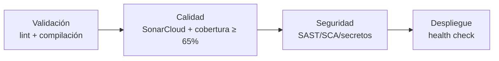

# Calidad de software - Sprint 1 y Sprint 2

## 1. Propósito y alcance

Este documento describe el plan de calidad y pruebas de Bookly Backend para el Sprint 1 (7 HU según el tablero real de Azure DevOps: HU-01, HU-02, HU-03, HU-06, HU-20, HU-21, HU-22), el estado real de la suite de pruebas, y lo que falta para cumplir el Quality Gate exigido por los `Lineamientos.md` antes del cierre del sprint (23/09/2026).

**Actualización del 2026-11-03:** el documento se alineó con el estado real de `main` tras el Sprint 2 (suite de 418 métodos de prueba en 79 clases, 422 ejecuciones según SonarCloud; módulos `booking`, `availability`, `schedule`, `audit`, `notification` y MFA; smoke tests; migración de JWT a `jjwt`). El estado actual de SonarCloud y de los criterios de `Lineamientos.md` está en la sección 18.

**Actualizado el 2026-09-21:** el rol `PATIENT` se renombró a `CUSTOMER` en todo el código (PR #12, migración Flyway `V4`) — este documento ya usa el nombre real. **Segunda actualización, mismo día:** se agregó `JwtTokenServiceTest` (PR #18, Quality Gate `OK`) y se corrigió en el tablero de Azure DevOps la anomalía de HU-21 (ver secciones 6, 8 y 10).

Los criterios de aceptación en Gherkin de cada HU viven en `HU_Reservas_Empresa_Unica.md`; este documento  los usa como base de trazabilidad hacia las pruebas automatizadas.

## 2. Requisitos de calidad exigidos para el equipo avanzado.

Según `Lineamientos.md`, secciones 3.5, 7.2 y 9.1:

| Dimensión | Criterio mínimo | Obligatoriedad |
|---|---|---|
| Análisis estático | SonarCloud con Quality Gate activo | Debe (bloquea DoD, sección 9.1) |
| Cobertura unitaria | ≥ 65% | Debe (resuelve contradicciones de umbral, sección 1.2.4) |
| Deuda técnica | Remediación máx. 2 días | Debe |
| Complejidad ciclomática | < 50 (evaluar también cognitiva) | Debe |
| Vulnerabilidades | Cero críticas | Debe |
| Historias de usuario | Criterios de aceptación en Gherkin | Debe |
| Pipeline (etapa Calidad) | SonarCloud, cobertura ≥65% | Debe (sección 7.2) |

## 3. Plan de calidad por sprint (Lineamientos 3.7)

| Sprint | Entregable exigido | Estado en `backendcf` |
|---|---|---|
| 1 | Plan de calidad y pruebas; Gherkin para HU prioritarias | Gherkin completo en `HU_Reservas_Empresa_Unica.md` (22 HU, sincronizado contra el tablero real). Este documento cubre el plan de pruebas. |
| 2 | Registro de defectos; SonarCloud activo; cobertura medida; pruebas con patrón AAA | Pipeline y JaCoCo activos (sección 7); el análisis de SonarCloud corre en cada PR/push. Cobertura global **92.6%** (≥ 65% exigido). Defectos corregidos en el sprint listados en la sección 20. **Quality Gate de `main` en `ERROR`** al 2026-11-03 por un único bug (sección 18) |
| 3 | Automatización de criterios de aceptación; ejecución E2E | No iniciado — depende de que Sprint 1 y 2 cierren cobertura unitaria primero |

## 4. Trazabilidad HU → Gherkin → prueba automatizada

### HU-01 — Registro de cliente

| Escenario Gherkin | Prueba automatizada | Estado |
|---|---|---|
| Registro exitoso con datos válidos | `RegisterCustomerServiceTest.registroExitosoCreaLaCuentaConRolClienteYPasswordHasheado` | Cubierto |
| Intento de registro con correo ya usado | `RegisterCustomerServiceTest.registroConCorreoYaRegistradoRechazaLaSolicitud` | Cubierto |
| Intento de registro con contraseña débil | `RegisterCustomerServiceTest.registroConContrasenaDebilEsRechazadoPorLaValidacionDelContrato` (valida el contrato `@Pattern` de `RegisterCustomerRequest` directamente) | Cubierto |

### HU-03 — Inicio de sesión seguro

| Escenario Gherkin | Prueba automatizada | Estado |
|---|---|---|
| Inicio de sesión exitoso | `LoginServiceTest.loginExitosoEntregaTokenYReiniciaContador` | Cubierto |
| Credenciales incorrectas en el login | `LoginServiceTest.credencialesIncorrectasDevuelvenErrorYRegistranIntento` | Cubierto |
| Bloqueo de cuenta tras intentos fallidos repetidos | `LoginServiceTest.quintoIntentoFallidoBloqueaLaCuenta` | Cubierto |

### HU-21 — Control de acceso a recursos ajenos

| Escenario Gherkin | Prueba automatizada | Estado |
|---|---|---|
| Dueño accede a su propio recurso | `OwnershipGuardTest.elDuenoDelRecursoPuedeAccederASuPropioRecurso` | Cubierto |
| Administrador accede a cualquier recurso | `OwnershipGuardTest.unAdministradorPuedeAccederACualquierRecurso` | Cubierto |
| Tercero sin permisos es rechazado (403 + log JSON) | `OwnershipGuardTest.unUsuarioNoPuedeAccederAlRecursoDeOtro` | Cubierto |

Mecanismo genérico (`shared/security/OwnershipGuard`), independiente de HU-08 (no existe todavía la entidad `Reserva`) — mergeado en PR #13, Quality Gate `OK`.

### HU-22 — Creación de especialistas y profesionales

| Escenario Gherkin | Prueba automatizada | Estado |
|---|---|---|
| Registro exitoso de profesional | `RegisterProfessionalServiceTest.registroExitosoCreaLaCuentaConRolProfesionalYElPerfilDeEspecialidad` | Cubierto |
| Correo ya registrado | `RegisterProfessionalServiceTest.registroConCorreoYaRegistradoRechazaLaSolicitud` | Cubierto |
| Contraseña débil | `RegisterProfessionalServiceTest.registroConContrasenaDebilEsRechazadoPorLaValidacionDelContrato` | Cubierto |

Implementada y mergeada en el PR #15. La cobertura incluye registro exitoso, correo duplicado, contraseña débil y carrera de registro simultáneo.

### HU-02 — Configuración del catálogo de servicios

| Escenario Gherkin | Prueba automatizada | Estado |
|---|---|---|
| Registro correcto de un servicio en el catálogo | `ServiceOfferingServiceTest.registroCorrectoGuardaElServicioEnElCatalogoConEstadoActivo`, `ServiceOfferingControllerTest.registroCorrectoDevuelve201ConElServicioCreado` | Cubierto |
| Intento de registrar un servicio con datos obligatorios faltantes | `ServiceOfferingRequestValidationTest.shouldRejectBlankName/shouldRejectNullName/shouldRejectBlankCategory/shouldRejectNullCategory/shouldRejectNullPrice/shouldRejectZeroPrice`, `ServiceOfferingControllerTest.registroConCamposObligatoriosFaltantesDevuelve400ConLosCamposPendientes` | Cubierto |
| Consulta pública del catálogo | `ServiceOfferingServiceTest.consultaSinFiltroDeCategoriaDevuelveTodoElCatalogo/consultaConCategoriaFiltraPorEsaCategoria/consultaConCategoriaEnBlancoSeComportaComoSinFiltro`, `ServiceOfferingControllerTest.consultaDelCatalogoDevuelve200ConLosServiciosDisponibles/consultaDelCatalogoConFiltroDeCategoriaDevuelve200ConLosServiciosDeEsaCategoria` | Cubierto |

`ServiceOfferingServiceTest` (Mockito) también cubre el rechazo por nombre duplicado (`registroConNombreYaExistenteEnElCatalogoEsRechazado`), lógica de negocio detrás de la unicidad del catálogo que no está descrita literalmente en el Gherkin. `ServiceOfferingControllerTest` (`@WebMvcTest`) suma el caso de contrato HTTP 409 `SERVICE_ALREADY_EXISTS` (`registroConNombreDuplicadoDevuelve409ConErrorCodeServiceAlreadyExists`).

**Pendiente conocido, no cubierto por diseño (ver sección 6):** `ServiceOfferingService.create` sigue con el patrón check-then-act (`existsByNameIgnoreCase` → `save()` sin atomicidad) sin corregir; no se agregó test de condición de carrera para HU-02 todavía.

### HU-06 — Configuración de duración estándar de servicios

| HU | Prueba automatizada | Estado |
|---|---|---|
| HU-02 | Ninguna sobre `ServiceOfferingService` (la lógica de duplicado por nombre) | Sin cubrir |
| HU-06 | `ServiceOfferingRequestValidationTest`, `ServiceOfferingTest` (PR #14, Miguel) | Cubierto (dominio + validación del DTO), implementado y mergeado |

### HU-20 — Configuración inicial de la plataforma

| Escenario Gherkin | Prueba automatizada | Estado |
|---|---|---|
| Aprovisionamiento exitoso | `PlatformSetupServiceTest.aprovisionamientoExitosoCreaPlataformaYAdminConRolAdmin`, `PlatformSetupControllerTest.aprovisionamientoExitosoDevuelve201ConElIdentificadorDeLaPlataforma` | Cubierto |
| Rechazo de un segundo aprovisionamiento | `PlatformSetupServiceTest.segundoAprovisionamientoEsRechazadoCuandoYaExistePlataforma`, `PlatformSetupControllerTest.segundoAprovisionamientoDevuelve409ConErrorCodePlatformAlreadyConfigured` | Cubierto |
| Rechazo por datos incompletos | `PlatformSetupRequestValidationTest.requestSinNombreDePlataformaEsRechazadoPorElContrato`, `PlatformSetupControllerTest.requestSinNombreDevuelve400ConElContratoDeErrorCompleto` | Cubierto |
| La contraseña nunca se almacena en texto plano | `PlatformSetupServiceTest.elPasswordNuncaSeAlmacenaEnTextoPlanoYNoSeExponeEnLaRespuesta` | Cubierto |

HU-20 tiene sus 4 escenarios Gherkin cubiertos entre `PlatformSetupServiceTest` (capa de servicio, Mockito), `PlatformSetupRequestValidationTest` (contrato del DTO, Bean Validation) y `PlatformSetupControllerTest` (contrato HTTP vía `@WebMvcTest`, códigos 201/409/400). Adicionalmente, `PlatformSetupServiceTest.segundoAprovisionamientoConcurrenteEsRechazadoPorElIndiceUnicoDePlataforma` cubre la condición de carrera del índice único `uk_platform_singleton` señalada en la sección 6, y `PlatformSetupRequestValidationTest` suma dos casos de control (`name` en blanco y request válido) que no están descritos literalmente en el Gherkin.

### HU-07 — Consulta de disponibilidad de agenda

| Escenario Gherkin | Prueba automatizada | Estado |
|---|---|---|
| Ver franjas libres de un profesional | `AvailabilityServiceTest.devuelveLosBloquesLibresSegunLaDuracionDelServicio/noMuestraLosBloquesYaOcupados`, `AvailabilityCalculatorTest.generaBloquesConsecutivosDentroDeLaFranja/excluyeLosBloquesQueSeSolapanConUnaReserva/unaReservaContiguaNoBloqueaElBloqueSiguiente/ignoraLosBloquesQueYaPasaron`, `AvailabilityIntegrationTest.consultaLasFranjasRealesYExcluyeLasReservasConfirmadas/unaReservaCanceladaNoOcupaElBloque` (PostgreSQL real), `AvailabilityControllerSecurityTest.clienteConsultaLaDisponibilidad` | Cubierto. Los bloqueos manuales quedan fuera de alcance (ver `docs/HU-07-disponibilidad.md`) |
| Consultar disponibilidad en un profesional sin cupos libres | `AvailabilityServiceTest.sinFranjasLibresInformaYSugiereAmpliarElFiltro`, `AvailabilityIntegrationTest.sinHorariosEnElRangoInformaQueNoHayDisponibilidad/profesionalTotalmenteReservadoInformaQueNoHayDisponibilidad` | Cubierto |
| Control adicional: validación del rango y 404 | `AvailabilityServiceTest.rechazaParametrosFaltantes/rechazaUnRangoInvertido/rechazaUnRangoMayorAlMaximo/rechazaUnRangoCompletamenteEnElPasado/profesionalInexistenteDevuelveNotFound/servicioInexistenteOInactivoDevuelveNotFound`, `GlobalExceptionHandlerTest.transformaUnaConsultaDeDisponibilidadInvalidaEnErrorBadRequest` | Cubierto |
| Control adicional: autorización (solo `CUSTOMER`) | `AvailabilityControllerSecurityTest.sinTokenDevuelveUnauthorized/profesionalRecibeForbiddenAlConsultarLaDisponibilidad/administradorRecibeForbiddenAlConsultarLaDisponibilidad` | Cubierto |

## 5. Estado real de la suite de pruebas

Fuente: conteo de métodos `@Test`/`@ParameterizedTest` en `src/test` sobre `main` (commit `969452a`, 2026-11-03) y análisis de SonarCloud de ese mismo commit: **418 métodos de prueba en 79 clases; SonarCloud reporta 422 ejecuciones, 0 fallos**.

| Módulo (`src/test/java/com/bookly/backendcf/`) | Clases | Métodos | HU / foco |
|---|---|---|---|
| `auth` | 17 | 105 | HU-01, HU-03, HU-17, HU-18 (MFA/TOTP), JWT, recuperación de contraseña, límite de intentos por IP, seguridad de controladores |
| `booking` | 15 | 97 | HU-08, HU-09; concurrencia e integración contra PostgreSQL real; lectura de reservas por dueño |
| `quality` | 7 | 46 | Colectores de métricas de SonarCloud y JaCoCo (tooling interno, ver sección 19) |
| `availability` | 5 | 32 | HU-07 (servicio, dominio, adaptador, integración con PostgreSQL real, seguridad) |
| `catalog` | 4 | 29 | HU-02, HU-06 |
| `audit` | 7 | 26 | HU-19 (servicio, listeners, persistencia, seguridad del endpoint) |
| `professional` | 6 | 23 | HU-22, asignación de servicios a profesionales |
| `schedule` | 2 | 17 | HU-04 |
| `notification` | 5 | 15 | HU-10 |
| `platform` | 3 | 10 | HU-20 |
| `shared` | 4 | 10 | HU-21 (`OwnershipGuard`), `GlobalExceptionHandler`, identidad del actor |
| `smoke` | 3 | 7 | Arranque del contexto y endpoints básicos (ver sección 19) |
| `BackendcfApplicationTests` | 1 | 1 | Contexto Spring |

**Pruebas que requieren PostgreSQL real** (`localhost:55432`, base `bookly_test`): `AvailabilityIntegrationTest`, `BookingConcurrencyTest`, `BookingCancellationConcurrencyTest` y `BookingCancellationIntegrationTest`. El workflow `ci.yml` levanta ese PostgreSQL como servicio; en local hay que arrancarlo a mano (sección 9). El resto corre contra H2.

**Componentes que en Sprint 1 figuraban sin prueba directa y hoy sí la tienen:** `AuthController` (`AuthControllerSecurityTest`, `AuthLoginIpLimitTest`) y `GlobalExceptionHandler` (`GlobalExceptionHandlerTest`, `GlobalExceptionHandlerSecurityTest`). `JwtAuthenticationFilter` no tiene una clase de prueba propia; se ejerce de forma indirecta en los tests `*SecurityTest`, que autentican con tokens reales.

`LoginServiceTest` sigue simulando el repositorio con un `Proxy` de reflexión hecho a mano en vez de Mockito (pendiente de Sprint 2 sin resolver). El resto de la suite usa Mockito, `@WebMvcTest` o pruebas de unidad planas.

## 6. Defectos y riesgos de calidad detectados

| Riesgo | Ubicación | Impacto |
|---|---|---|
| Carrera de duplicados (check-then-act sin atomicidad) | **Pendiente solo en** `ServiceOfferingService.create` (`existsByNameIgnoreCase` → `save()`). `RegisterCustomerService` y `PlatformSetupService` ya usan `saveAndFlush` con `catch (DataIntegrityViolationException)` | Dos solicitudes concurrentes que creen el mismo servicio pueden generar una excepción de integridad no mapeada a un 409 controlado |
| ~~JWT construido a mano~~ **Resuelto** | `JwtTokenService` | Migrado a la librería `io.jsonwebtoken` (`jjwt`, commit `3780cd5`; ver `ADR-009`). `JwtTokenServiceTest` (15 métodos) se actualizó en esa misma migración. El commit `be56637` (SEC-003) además rechaza secretos JWT de baja entropía |
| Secreto JWT no persistente | `JwtTokenService` | El constructor ya rechaza secreto vacío o menor a 32 bytes (falla al arrancar si `JWT_SECRET` no está seteado, en vez de generar uno aleatorio) — cubierto por dos de los diez casos de `JwtTokenServiceTest` (PR #18) |

**A favor:** `RegisterProfessionalService`, `RegisterCustomerService` y `PlatformSetupService` resuelven el patrón de carrera con `saveAndFlush` dentro de un `try/catch` de `DataIntegrityViolationException`. Ese mismo patrón es la referencia para corregir `ServiceOfferingService.create`.

## 7. Pipeline de calidad (CI/SonarCloud)

### 7.1 Etapas del pipeline mínimo exigido



`ci.yml` implementa hoy Validación (`mvnw compile`) y la mitad de Calidad (tests + JaCoCo + análisis real de SonarCloud, ya funcionando). Seguridad (SAST/SCA/detección de secretos) y Despliegue todavía no existen en el workflow. **Nuevo hallazgo:** `backendcf` nunca se desplegó en Render ni en ningún otro lado — dato relevante para cuando se arme la etapa de Despliegue.

### 7.2 JaCoCo

Agregado en `pom.xml` (`jacoco-maven-plugin` 0.8.12, ejecuciones `prepare-agent` y `report` en fase `test`). Genera `target/site/jacoco/jacoco.xml`, que es el reporte que `sonar.coverage.jacoco.xmlReportPaths` le entrega a SonarCloud.

### 7.3 Bloqueo de SonarCloud — RESUELTO (2026-09-17)

El bloqueo original (`Not authorized or project not found`, causado por el proyecto tener activo "Automatic Analysis" en SonarCloud en vez de "Use CI") **ya se resolvió**: alguien con rol Admin en SonarCloud cambió el modo del proyecto. Confirmado con una corrida real en `main`:

```
[INFO] ANALYSIS SUCCESSFUL, you can find the results at:
https://sonarcloud.io/dashboard?id=Code-Factory-Bookly_backendcf&branch=main
```

`sonar.organization` (`code-factory-bookly`) y `sonar.projectKey` (`Code-Factory-Bookly_backendcf`) en `pom.xml` están confirmados correctos.

**Nota sobre `continue-on-error` en el paso de Sonar:** el PR #6 (Copilot) lo agregó como parche temporal mientras el bloqueo estaba activo. Se intentó sacar (PR #11) pero se cerró sin mergear a pedido del equipo — **sigue en `ci.yml` a propósito**. Esto significa que hoy un PR puede mostrarse "verde" en GitHub aunque el Quality Gate real de SonarCloud esté en rojo — **siempre verificar el gate real** (sección siguiente), no solo el check de GitHub. Nota que solo aplica en `pull_request`; en push a `main` el paso de Sonar sí puede tumbar el job entero (pasó exactamente eso el 22/09, ver el incidente de abajo).

**Incidente del 22/09 — `SONAR_TOKEN` rechazado, ya resuelto:** entre el merge del PR #15 (00:48) y el PR #22 (05:12), las 8 corridas de CI en `main` fallaron con `HTTP 403 Forbidden. Please check ... SONAR_TOKEN` — el token había quedado inválido. `Compilar` y `Tests y cobertura` seguían pasando bien; solo el análisis de Sonar se caía. Se regeneró el token en SonarCloud y se actualizó el secreto en GitHub (17:43); se reintentó la corrida (`gh run rerun`, sin necesitar un commit nuevo) y terminó en verde.

**Estado real del Quality Gate:** consultar siempre la API y no solo el check de GitHub. El estado al 2026-11-03 (commit `969452a`) está en la sección 18; comando:

```
GET https://sonarcloud.io/api/qualitygates/project_status?projectKey=Code-Factory-Bookly_backendcf&branch=main
```

También existe `qa-tests/scripts/sonar-metrics.sh`, que consulta la API y evalúa los criterios de calidad del equipo (requiere `jq`).

## 8. Pruebas pendientes para cerrar Sprint 1

Actualizado con las 7 HU reales de Sprint 1:

1. ~~`RegisterCustomerServiceTest`~~ — hecho (HU-01, 3 escenarios).
2. ~~`UserAccountTest`~~ — hecho (6 pruebas de reglas de dominio).
3. ~~`OwnershipGuardTest`~~ — hecho (HU-21, 3 escenarios, mecanismo genérico independiente de HU-08).
4. ~~`RegisterProfessionalServiceTest`~~ — hecho e integrado (HU-22, 4 escenarios incluyendo la carrera de registro simultáneo).
5. ~~`ServiceOfferingTest` / `ServiceOfferingRequestValidationTest`~~ — hecho e integrado (HU-06).
6. ~~`JwtTokenServiceTest`~~ — hecho e integrado (10 escenarios: firma/payload alterado, expiración, secreto distinto, estructura inválida y validación del constructor).
7. ~~`ServiceOfferingService` (HU-02)~~ — hecho e integrado; `registroConNombreYaExistenteEnElCatalogoEsRechazado` cubre el duplicado por nombre (sección 4).
8. ~~`PlatformSetupServiceTest` (HU-20)~~ — hecho e integrado (10 tests entre servicio, controlador y validación del DTO, sección 4).
9. ~~`AuthController` y `GlobalExceptionHandler`~~ — hecho (ver sección 5). Solo `JwtAuthenticationFilter` carece de una clase de prueba propia; se cubre de forma indirecta.

Las 7 HU de Sprint 1 tienen cobertura automatizada completa.

## 9. Ejecución local

```bash
./mvnw test
```

Reporte de cobertura generado en:

```
target/site/jacoco/jacoco.xml   # formato que consume SonarCloud
target/site/jacoco/index.html   # reporte navegable
```

Análisis local contra SonarCloud (una vez resuelto el bloqueo de la sección 7.3):

```bash
export SONAR_TOKEN=$(cat ~/.sonar_token)
./mvnw -B verify org.sonarsource.scanner.maven:sonar-maven-plugin:sonar
```
Las pruebas de integración (`BookingConcurrencyTest`, `AvailabilityIntegrationTest`) requieren un PostgreSQL local:

```bash
docker run -d --name bookly-test-db -e POSTGRES_DB=bookly_test -e POSTGRES_USER=bookly_test \
  -e POSTGRES_PASSWORD=bookly_test_local_2026 -p 55432:5432 postgres:16-alpine
```

## 10. Pendientes de evolución

### HU-19 — Registro de auditoría de acciones críticas

La integración funcional disponible quedó cubierta así:

| Acción | Adaptador | Evidencia automatizada |
|---|---|---|
| `BOOKING_CREATED` | `BookingCreatedAuditListener` | `BookingCreatedAuditListenerTest` |
| `ROLE_CHANGED` | `RoleChangedAuditListener` | `RoleChangedAuditListenerTest`, `RoleAssignmentServiceTest` |
| `BOOKING_CANCELLED` | `BookingCancelledAuditListener` | El listener existe en `main` desde HU-09, pero no tiene una clase de prueba propia (a diferencia de `BookingCreatedAuditListenerTest` y `RoleChangedAuditListenerTest`); pendiente |

La auditoría se publica de forma síncrona dentro de la transacción de negocio. Si la persistencia de
la bitácora falla, la operación de negocio no debe confirmarse. La persistencia e inmutabilidad de
PostgreSQL se validan adicionalmente con `AuditLogPersistenceTest` y
`docs/evidencia/HU-19-integridad.sql`.

Pendiente de Sprint 1 que sigue abierto: corregir el patrón de carrera check-then-act en `ServiceOfferingService.create` (los otros servicios ya lo corrigen).

**Resuelto el 2026-09-21:** la anomalía de HU-21 en el tablero de Azure DevOps (work item 32) — estaba sin Sprint asignado pese a estar mergeada desde el PR #13. Ya se movió a `Sprint 1` vía API. El `State` se dejó en `Active` a propósito (no se cerró unilateralmente el work item de David; falta que él lo pase a `Closed`).

Estado de las metas de Sprint 2 (Lineamientos 3.7): la cobertura de código nuevo está en 93.1% (supera el 80% del gate); quedan pendientes reescribir `LoginServiceTest` con Mockito en vez del `Proxy` manual, agregar la etapa de Seguridad al pipeline (SAST/SCA/detección de secretos) y armar la etapa de Despliegue (el workflow `ci.yml` solo compila, prueba y analiza). Los defectos del sprint se registraron con identificadores BUG-/SEC- y quedaron corregidos en PRs (sección 20).

Para Sprint 3: automatizar los criterios de aceptación Gherkin restantes y sumar ejecución E2E.

**Documentos formales** (según Clases 6 y 7 del curso): el SQAP (IEEE 730) y el Plan de Pruebas (IEEE 829/ISO 29119) no están versionados en este repositorio; se mantienen fuera de él.

### revisado por Adrian Espinosa
### co-redactado con codex.

## 11. HU-10 — Notificaciones de reserva

### Alcance probado

La implementación actual de HU-10 consume los eventos disponibles en `main`:

- `BookingCreatedEvent` para la confirmación de reserva.
- `BookingCancelledEvent` para la notificación de cancelación.
- `BookingRescheduledEvent` queda fuera de esta ejecución porque todavía no existe en el contrato
  de `booking`.

El adaptador `LoggingEmailNotificationAdapter` se mantiene como valor predeterminado para que las
pruebas no dependan de un servidor externo. `SmtpEmailNotificationAdapter` permite activar un
proveedor real mediante variables de entorno, sin credenciales en el repositorio.

### Trazabilidad Gherkin → pruebas

| Escenario | Prueba automatizada | Estado |
|---|---|---|
| Se procesa una confirmación y se registra como enviada | `NotificationServiceTest.procesaCreacionYMarcaElCorreoComoEnviado` | Cubierto |
| Un fallo del proveedor se registra como `FAILED` | `NotificationServiceTest.registraFalloDelProveedorSinPropagarLaExcepcion` | Cubierto |
| El mismo evento no genera un segundo correo | `NotificationServiceTest.eventoYaProcesadoNoVuelveAEnviarCorreo` | Cubierto |
| El evento de cancelación contiene los datos de la reserva | `CancelBookingServiceTest` — captura de `BookingCancelledEvent` | Cubierto |
| El evento tiene identificador único para idempotencia | `BookingDtoTests.bookingCreatedEventConstructor`, `CancelBookingServiceTest` | Cubierto |
| El listener procesa después del commit | `BookingNotificationListenerIntegrationTest.procesaElEventoSoloDespuesDelCommit` | Cubierto |
| El listener no procesa un rollback | `BookingNotificationListenerIntegrationTest.noProcesaElEventoCuandoLaTransaccionHaceRollback` | Cubierto |

### Criterios negativos y de seguridad

- El correo no se envía dos veces para el mismo `eventId`.
- Un error del adaptador no propaga la excepción hacia la operación de reserva.
- El error técnico se conserva en `notification_delivery` sin credenciales ni tokens.
- La información de cliente, servicio y profesional se resuelve mediante puertos de lectura.
- La notificación se procesa con `AFTER_COMMIT`; no debe revertir una reserva confirmada.

### Evidencia ejecutada

Pruebas focalizadas ejecutadas correctamente:

```bash
./mvnw -q -Dtest=NotificationServiceTest,BookingDtoTests,CancelBookingServiceTest test
```

Resultado: **29 pruebas ejecutadas, 0 fallos y 0 errores**.

Compilación verificada:

```bash
./mvnw -q -DskipTests compile
```

La migración `V43__create_notification_delivery.sql` también fue aplicada contra PostgreSQL 16.15
en Docker. Se verificaron la tabla, la FK hacia `bookings`, la unicidad de `event_id`, las
restricciones `CHECK` y los índices operativos. La migración `V44__cascade_notification_delivery_booking.sql`
ajusta la FK para que la limpieza de una reserva no quede bloqueada por su registro técnico.

Suite completa ejecutada con una base PostgreSQL de pruebas en `localhost:55432`:

```bash
./mvnw test
```

Resultado de la suite base: **264 pruebas ejecutadas, 0 fallos y 0 errores**.

Con las pruebas de integración `AFTER_COMMIT`, SMTP y contrato de reprogramación incorporadas, la
suite completa actual queda en **268 pruebas ejecutadas, 0 fallos y 0 errores**.

### Pendientes de QA para cerrar HU-10

1. Validar el contenido final de las plantillas con datos representativos del negocio.
2. Configurar y probar las credenciales SMTP del entorno de despliegue, sin incorporarlas al código.
3. Agregar casos de reprogramación cuando `booking` publique `BookingRescheduledEvent`.

## 12. HU-04 — Horario de atención semanal del profesional

| Escenario Gherkin | Prueba automatizada | Estado |
|---|---|---|
| Profesional configura su horario semanal | `WeeklyScheduleServiceTest.guardaHorarioValidoYReemplazaElAnterior`, `WeeklyScheduleServiceTest.aceptaFranjasContiguas` | Cubierto |
| Intento de definir franjas superpuestas | `WeeklyScheduleServiceTest.rechazaFranjasSuperpuestasConElDetalleDelConflicto`, `WeeklyScheduleServiceTest.rechazaHoraFinAnteriorALaDeInicio` | Cubierto |
| Control adicional: profesional inexistente | `WeeklyScheduleServiceTest.profesionalInexistenteDevuelveNotFound` | Cubierto |
| Control adicional: autorización (dueño o ADMIN) | `ScheduleControllerSecurityTest.sinTokenDevuelveUnauthorized/clienteDevuelveForbidden/profesionalNoPuedeEditarHorarioAjeno/profesionalPuedeEditarSuPropioHorario` | Cubierto |

El solapamiento se valida en el servicio, no con una restricción de exclusión en la base (`uk_horario_semanal_inicio` solo impide dos franjas con la misma hora de inicio exacta). Queda como mejora si el equipo la quiere (ver ADR-006).

## 13. HU-17 — Asignación de roles y permisos (RBAC)

| Escenario Gherkin | Prueba automatizada | Estado |
|---|---|---|
| Asignar un rol a un usuario | `RoleAssignmentServiceTest.clienteSeConvierteEnProfesionalCreandoSuPerfil`, `UserRoleControllerSecurityTest.administradorPuedeAsignarRoles` | Cubierto |
| Intento fallido de cambiar el rol de un usuario con compromisos activos | `RoleAssignmentServiceTest.profesionalConPerfilNoPuedeVolverseCliente` (bloquea por perfil profesional existente, no por citas activas — ver nota) | Cubierto parcialmente |
| Usuario intenta acceder a una función fuera de sus permisos | `UserRoleControllerSecurityTest.sinTokenDevuelveUnauthorized/clienteNoPuedeAsignarRoles/profesionalNoPuedeAsignarRoles` | Cubierto |
| Control adicional: especialidad obligatoria al promover a PROFESSIONAL | `RoleAssignmentServiceTest.clienteAProfesionalSinEspecialidadEsRechazado` | Cubierto |
| Control adicional: cambio al mismo rol es una operación nula | `RoleAssignmentServiceTest.mismoRolNoModificaNada` | Cubierto |
| Control adicional: búsqueda de usuarios para asignar el rol (`GET /usuarios/buscar`) | `RoleAssignmentServiceTest.busquedaSinTextoDevuelveSugerenciasExistentes/busquedaConTextoFiltraPorCorreoONombreYMarcaPerfilProfesional/busquedaConUnSoloCaracterSeTrataComoSinTexto`, `UserRoleControllerSecurityTest.busquedaSinTokenDevuelveUnauthorized/busquedaClienteDevuelveForbidden/busquedaAdministradorDevuelveCoincidencias/busquedaSinParametroQUsaCadenaVacia` | Cubierto |

**Pendiente conocido, no cubierto por diseño:** el Gherkin de HU-17 pide rechazar el cambio de rol cuando el usuario tiene "citas activas programadas". Lo que el código hoy rechaza es distinto: un `PROFESSIONAL` con **perfil creado** no puede cambiar a otro rol (`409 ROLE_CHANGE_CONFLICT`), sin consultar reservas. El escenario literal depende de que `booking` exponga una consulta de reservas activas por usuario; no existe todavía esa integración entre los módulos `auth` y `booking`.

**Resuelto, corrección a esta misma sección:** al escribir esta nota por primera vez decía que el rol viajaba sin validar dentro del JWT y que un cambio de rol no se reflejaba hasta que el token expirara. Eso ya no es así — `JwtAuthenticationFilter` fue corregido (MantisBT BUG-005, commit `68dfb38`) para resolver el rol contra la base en cada petición en vez de confiar en el claim del token; ese fix ya estaba en `main` cuando se escribió la nota original, solo no se había verificado contra este código. Un cambio de rol con `PUT /usuarios/{userId}/rol` ya tiene efecto inmediato en la siguiente petición del usuario afectado, sin esperar a que expire su token.

## 14. HU-08 — Creación y agendamiento de reserva

| Escenario Gherkin | Prueba automatizada | Estado |
|---|---|---|
| Reserva exitosa sobre una franja disponible | `CreateBookingServiceTest.shouldCreateBookingSuccessfully`, `BookingControllerTest.shouldCreateBookingSuccessfully/shouldUseAuthenticatedCustomerId` | Cubierto |
| Dos clientes intentan reservar la misma franja de forma simultánea (condición de carrera) | `BookingConcurrencyTest.twoSimultaneousCustomersOnlyOneBookingIsConfirmed` (concurrencia real contra PostgreSQL), `CreateBookingServiceTest.shouldRejectIfSlotOccupied`, `BookingControllerTest.shouldReturnConflictWhenSlotIsOccupied` | Cubierto |
| Control adicional: validación del rango horario | `CreateBookingServiceTest.shouldRejectIfStartTimeAfterEndTime/shouldRejectIfStartTimeInPast`, `BookingControllerTest.shouldReturnBadRequestForInvalidTimeRange/shouldReturnBadRequestForInvalidCustomerId` | Cubierto |
| Control adicional: lectura de reservas por dueño (`GET /reservas/cliente/{id}`, `GET /reservas/profesional/{id}`) | `BookingQuerySecurityTest.sinTokenDevuelve401/clientePuedeVerSusPropiasReservas/clienteNoPuedeVerLasReservasDeOtroClienteDevuelve403/profesionalPuedeVerSusPropiasReservas/administradorPuedeVerLasReservasDeCualquierCliente` | Cubierto |

La unicidad de la franja la garantiza la base con la restricción `unique_booking_per_professional_time` (`V30__create_bookings.sql`); el servicio traduce la violación a `409 SLOT_OCUPADO` (ADR-006).

**Nota de limpieza de QA (resuelta):** `BookingComprehensiveTest.java` era código de prueba muerto (nombre fuera de la convención de Surefire, duplicado de `CreateBookingServiceTest`); se eliminó en el commit `a6ee506` y ya no existe en el repositorio.

## 15. HU-09 — Cancelación autónoma de reservas

| Escenario Gherkin | Prueba automatizada | Estado |
|---|---|---|
| Cancelación exitosa dentro del tiempo permitido | `CancelBookingServiceTest.shouldCancelBookingWithThreeHoursNotice/shouldAllowCancellationAt121Minutes/shouldAllowCancellationAtExactly120Minutes`, `CancelBookingControllerTest.shouldCancelBookingSuccessfully/shouldAllowRequestWithoutReason` | Cubierto |
| Intento de cancelación fuera del plazo de anticipación permitido | `CancelBookingServiceTest.shouldRejectCancellationWithFortyFiveMinutesNotice/shouldRejectCancellationAt119Minutes` | Cubierto |
| Control adicional: solo el cliente dueño cancela | `CancelBookingServiceTest.shouldRejectCancellationByAnotherCustomer`, `CancelBookingControllerTest.shouldPropagateAccessDeniedForAnotherCustomer`, `CancelBookingSecurityTest.administradorNoPuedeCancelarDevuelve403/profesionalNoPuedeCancelarDevuelve403` | Cubierto |
| Control adicional: estados inválidos | `CancelBookingServiceTest.shouldRejectAlreadyCancelledBooking/shouldRejectMissingBooking`, `CancelBookingControllerTest` (contrato HTTP) | Cubierto |

El plazo mínimo (`BOOKING_CANCELLATION_MIN_ADVANCE_MINUTES`, 120 por defecto) es configurable, no está fijado en el código — ver `CancelBookingServiceTest.shouldRejectCancellationAt119Minutes` / `shouldAllowCancellationAtExactly120Minutes` para el límite exacto.

## 16. HU-18 — Autenticación multifactor (MFA) para accesos administrativos

| Escenario Gherkin | Prueba automatizada | Estado |
|---|---|---|
| Acceso administrativo con código MFA correcto | `MfaServiceTest.enrolamientoConCodigoValidoActivaTotpYEntregaDiezCodigosDeRecuperacion` | Cubierto |
| Código de segundo factor incorrecto o expirado | `MfaServiceTest.codigoIncorrectoEnVerificacionRegistraIntentoFallido` | Cubierto |
| Control adicional: no se puede reenrolar solo con la contraseña | `MfaServiceTest.noSePuedeReenrolarConSoloLaContrasena` | Cubierto |
| Control adicional: código de recuperación de un solo uso | `MfaServiceTest.codigoDeRecuperacionDeUsoUnicoFunciona` | Cubierto |
| Control adicional: regenerar códigos de recuperación | `MfaServiceTest.regenerarCodigosConCodigoValidoReemplazaLosAnteriores/regenerarCodigosSinMfaActivoFalla/regenerarCodigosConCodigoIncorrectoRegistraIntentoFallido`, `MfaSettingsControllerSecurityTest.regenerarDevuelveDiezCodigosNuevos` | Cubierto |
| Control adicional: desactivar el segundo factor | `MfaServiceTest.desactivarConContrasenaYCodigoValidosLimpiaElSegundoFactor/desactivarConContrasenaIncorrectaFalla`, `MfaSettingsControllerSecurityTest.desactivarConCredencialesValidasDevuelveNoContent/desactivarSinTokenDevuelveUnauthorized` | Cubierto |
| Control adicional: omitir el enrolamiento ("preguntar de nuevo la próxima vez", ADR-010) | `MfaServiceTest.omitirLaConfiguracionEntregaSesionSinActivarMfa/omitirLaConfiguracionConMfaYaActivoFalla` | Cubierto |
| Control adicional: autorización de las rutas de administración del propio MFA | `MfaSettingsControllerSecurityTest.estadoSinTokenDevuelveUnauthorized/estadoClienteDevuelveForbidden/estadoAdministradorDevuelveCodigosRestantes` | Cubierto |

El secreto TOTP se cifra con `MFA_ENCRYPTION_KEY` (AES-256) antes de persistirse; si esa clave cambia, los secretos ya guardados quedan indescifrables (ver README.md, sección de variables de entorno). El alcance es exclusivo de `ADMIN`: `CUSTOMER` y `PROFESSIONAL` nunca pasan por un reto de MFA al iniciar sesión.

## 17. Evidencia ejecutada (Sprint 2, HU-04/08/09/17/18)

```bash
./mvnw -q -Dtest='!AvailabilityIntegrationTest,!BookingCancellationConcurrencyTest,!BookingCancellationIntegrationTest,!BookingConcurrencyTest' test
```

Ejecutado localmente contra H2 (sin la base PostgreSQL de integración que usa el CI para las pruebas de concurrencia e integración real): **303 pruebas, 0 fallos, 0 errores**, incluidas `WeeklyScheduleServiceTest`, `ScheduleControllerSecurityTest`, `RoleAssignmentServiceTest`, `UserRoleControllerSecurityTest`, `CreateBookingServiceTest`, `BookingControllerTest`, `CancelBookingServiceTest`, `CancelBookingControllerTest`, `CancelBookingSecurityTest`, `BookingQuerySecurityTest`, `MfaServiceTest` y `MfaSettingsControllerSecurityTest`. Las cuatro clases que exigen PostgreSQL real en `localhost:55432` (`AvailabilityIntegrationTest` y las tres de `booking` de concurrencia/integración) y el reporte de cobertura consolidado quedan a cargo del pipeline de CI, que sí tiene ese Postgres disponible.

## 18. Estado de SonarCloud y criterios de `Lineamientos.md` (2026-11-03)

Fuente: API pública de SonarCloud, `branch=main`, análisis del commit `969452a` (2026-11-03). Reproducible con los comandos de la sección 7.3.

### Quality Gate: `ERROR`

| Condición | Umbral | Actual | Estado |
|---|---|---|---|
| Fiabilidad en código nuevo | rating A | D (4) | Falla |
| Seguridad en código nuevo | rating A | A | Cumple |
| Mantenibilidad en código nuevo | rating A | A | Cumple |
| Cobertura en código nuevo | ≥ 80% | 93.1% | Cumple |
| Duplicación en código nuevo | ≤ 3% | 0.4% | Cumple |
| Hotspots de seguridad revisados | 100% | 100% | Cumple |

El "código nuevo" se mide desde la versión de referencia del 2026-09-16 (`previous_version`), por lo que abarca casi todo el proyecto.

### Métricas globales

| Métrica | Valor |
|---|---|
| Cobertura global / líneas / ramas | 92.6% / 94.8% / 82.2% |
| Tests / fallos | 422 / 0 |
| Líneas de código (ncloc) | 6,471 |
| Deuda técnica | 0 min (rating A) |
| Duplicación global | 0.8% |
| Hotspots de seguridad | 0 |
| Vulnerabilidades | 0 (rating de seguridad A) |
| Complejidad ciclomática total / cognitiva total | 852 / 346 |

### Criterios de `Lineamientos.md` (secciones 3.5, 7.2, 9.1)

| Criterio | Meta | Actual | Estado |
|---|---|---|---|
| Análisis estático con Quality Gate activo | gate pasando | `ERROR` | No cumple |
| Cobertura unitaria | ≥ 65% | 92.6% | Cumple |
| Deuda técnica | ≤ 2 días | 0 min | Cumple |
| Complejidad ciclomática | < 50 (también cognitiva) | Por clase, `QualityMetricsReporter` tiene 53 y `MfaService` 45; ningún método supera la complejidad cognitiva de 15 que Sonar marca por defecto | Cumple por clase salvo `QualityMetricsReporter` (tooling interno) |
| Vulnerabilidades críticas | cero | 0 | Cumple |

El criterio de complejidad no precisa si se mide por proyecto o por clase; este documento y `qa-tests/scripts/sonar-metrics.sh` lo evalúan por clase.

### Issues abiertos

| Regla | Severidad | Ubicación | Estado |
|---|---|---|---|
| `java:S9352` (bug) | Crítica | `NotificationService.java:43` | Sonar sigue marcando la ambigüedad entre `loggingEmailNotificationAdapter` y `smtpEmailNotificationAdapter`, aunque el PR #65 movió la elección del adaptador a `EmailNotificationConfiguration`. Es el único issue que mantiene el gate en `ERROR`; verificar en el siguiente análisis si desaparece o si hay que marcarlo como falso positivo |
| `java:S2699` (code smell) | Bloqueante | `QualityMetricsReporterTest.java:159` | **Resuelto** con el PR #66 (test sin aserción corregido); ya no aparece en el análisis de `969452a` |

## 19. Smoke tests, perfiles de ejecución y herramientas de calidad

- **Smoke tests** (`src/test/java/.../smoke/`, 7 métodos): `SmokeTest` (arranque del contexto), `PublicEndpointsSmokeTest` (endpoints públicos y protegidos) y `AuthFlowSmokeTest` (registro y login). Se ejecutan con `./mvnw -B test -Psmoke`. Ver `src/test/java/com/bookly/backendcf/smoke/README.md`.
- **Perfiles Maven:** `smoke` filtra por `@Tag("smoke")`. `unit-only` e `integration-only` filtran por `@Tag("unit")` y `@Tag("integration")`, etiquetas que ninguna prueba usa hoy, así que esos dos perfiles ejecutarían cero pruebas hasta que se etiqueten.
- **Módulo `quality/`:** imprime un reporte de métricas de calidad al arrancar la aplicación (colectores de SonarCloud y JaCoCo con caché). Es tooling interno: `sonar.coverage.exclusions` lo excluye de la cobertura (`**/quality/**`) pero sigue sujeto al resto del análisis estático.
- **`qa-tests/scripts/sonar-metrics.sh`:** consulta la API de SonarCloud y evalúa los criterios de calidad del equipo. Requiere `curl`, `jq`, `awk` y `git`.
- **Pipeline:** `ci.yml` compila, ejecuta las pruebas (con PostgreSQL 16 como servicio en el puerto 55432) y lanza el análisis de SonarCloud. No tiene etapa de seguridad (SAST/SCA/secretos) ni de despliegue.

## 20. Defectos del Sprint 2 corregidos

Los defectos se identifican con códigos `BUG-`/`SEC-` (MantisBT) y con números en el nombre de la rama (`bug-181` a `bug-191`); cada corrección entró a `main` por un PR o commit:

| Área | PR / commit | Corrección |
|---|---|---|
| Reservas | #46 | Permitir cancelación de reservas por ADMIN (HU-09) |
| Reservas | #47 | Validar la disponibilidad del profesional al crear reservas (HU-08) |
| Reservas | #48 | Evitar solapamiento de reservas concurrentes (HU-08) |
| Reservas | #54 | Evitar enumeración de IDs en cancelaciones no autorizadas |
| MFA | #50 | Garantizar la persistencia de los 10 códigos de recuperación |
| MFA | #52 | Permitir la reconfiguración después de desactivar MFA |
| Horarios | #51, #53, #55 | Devolver 400 para horarios inválidos, rechazar tipos de datos inválidos y devolver 404 para profesionales inexistentes |
| Búsqueda | #56 | No exponer usuarios con consultas cortas |
| Auditoría | #57 | Definir fechas predeterminadas en las consultas de auditoría |
| Autenticación | `ba43b29` (BUG-001), `68dfb38` (BUG-005) | Recortar el correo antes de validar el formato; resolver el rol contra la base en cada petición |
| Autenticación | `97b7b6f` (SEC-006, SEC-014), `be56637` (SEC-003) | Bloqueo de login por IP, filtro de dominios desechables y rechazo de secretos JWT de baja entropía |

La columna de corrección resume el título del PR o commit; el detalle de cada defecto está en el registro de defectos del equipo.
